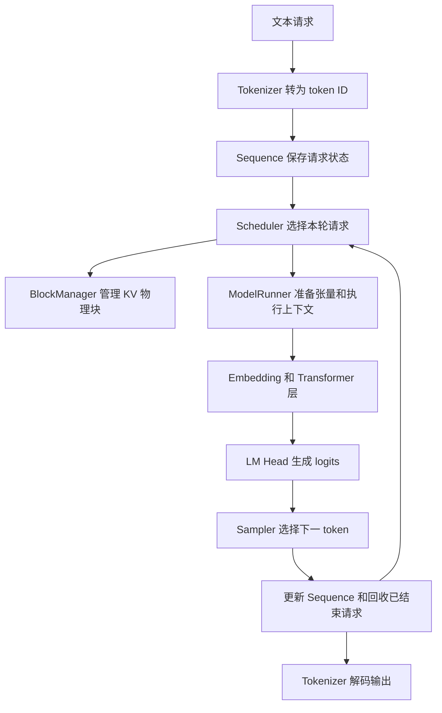

# 在 GPU 上从零实现 nano-vllm 的全部功能

这份指南面向会写基础 Python、还没有独立实现过推理引擎的读者。目标是在你的 GPU 机器上，从空目录开始，亲手实现当前 nano-vllm 已有的全部功能。完成标准包含真实 Qwen3 权重、FlashAttention、Triton 分页 KV、连续批处理、分块 Prefill、前缀共享、抢占重算、自动显存预算、编译优化、CUDA Graph、Tensor Parallel、进程通信与完整离线生成 API。

主线环境为 Linux 与 NVIDIA CUDA GPU。单卡完成模型、调度、缓存和 Graph；TP 实测需要至少两张兼容 GPU。所有阶段均是最终实现的一部分，前面的简化版本只作为逐步推导和数值参照。每完成一层，都用上一层验证它，再继续添加功能。

从 [第一课完整代码](/Users/shinn/Documents/opensource/nano-vllm/docs/learning/step01_model_and_generate.py) 开始：只导入 PyTorch，按顺序亲手定义全部模型类，创建 model 实例，再执行前向和生成。加入 KV Cache 后，用 [缓存数学参考](/Users/shinn/Documents/opensource/nano-vllm/docs/learning/tiny_reference.py) 做等价对照。[GPU 验收脚本](/Users/shinn/Documents/opensource/nano-vllm/docs/learning/gpu_acceptance.py) 用于检查随后完成的真实 GPU 模块与引擎，可通过 `--package myvllm` 指向自己的实现。

第 1 至 26 章讲清计算、状态和源码；第 27 至 32 章给出完整模块接口、GPU 接线代码、分阶段验收命令与最终完成条件。短代码片段需要放入相应模块，结构伪代码在相邻文字中标明；新增的 GPU 实作章节给出此前容易缺失的连接步骤。

项目对照基于 2026 年 11 月 3 日的本地工作区，Git 基线为 `bb823b3`，包含工作区已有修改。“项目实现”描述当前文件；“中间版本”表示最终还要继续演进的实现。本文的 GPU 命令在你的 GPU 机器执行；本次未连接该机器，GPU 实测状态由你运行验收后确定。

## 1 先明确你在实现什么

一次语言模型生成可以拆成两个不同职责。

**模型负责计算：**给定 token 和位置，生成每个候选下一 token 的分数。分数叫 logits，词表中每个 token 对应一个数。

**引擎负责组织：**哪些请求这轮运行、每条请求运行多少 token、历史 K/V 放在哪里、结果属于哪个请求、什么时候结束、什么时候释放显存。



实际代码里 BlockManager 由 Scheduler 调用，Attention 读取 ModelRunner 准备的缓存和元数据。图中的箭头表示职责与数据流，不能理解成每个框都启动一个线程。

“从零实现”在这里包含模型结构、缓存管理、调度、执行和采样；矩阵乘法仍交给 PyTorch，tokenizer 仍可使用 Transformers，权重读取仍可使用 safetensors。项目本身也是这种分工。

| 你负责写的东西       | 可以调用的基础工具                                      | 调用解决什么问题               |
| -------------------- | ------------------------------------------------------- | ------------------------------ |
| 模型结构和数据流     | `torch`、`torch.nn`                                 | 张量和基础算子                 |
| 文本与 ID 的转换     | `AutoTokenizer`                                       | 与预训练模型一致的分词规则     |
| 配置读取             | `AutoConfig`                                          | 层数、维度、位置编码等模型参数 |
| 权重加载与名字映射   | `safetensors.safe_open`                               | 读取已训练的参数               |
| 注意力的数学参考实现 | `matmul`、`softmax`                                 | 明确 Q/K/V 如何产生输出        |
| GPU 注意力优化       | `flash_attn_varlen_func`、`flash_attn_with_kvcache` | 执行高效注意力                 |
| KV 散写内核          | Triton                                                  | 按物理地址批量写入 KV          |
| 多卡通信             | `torch.distributed` 的 NCCL 后端                      | 求和、收集和进程同步           |

先写单 GPU、单进程、无分页、无前缀复用、无 CUDA Graph 的版本。在自己的版本里，普通 `nn.Linear` 可以直接工作，不需要为了一个请求先初始化 NCCL。项目由于统一使用并行层，`tensor_parallel_size=1` 时也初始化进程组，这是它的实现选择。

## 2 用能验收的阶段组织目录

建立独立项目 `my-vllm`，Python 包叫 `myvllm`。最终目录直接对应原项目，避免学完简化目录后还要猜如何拆分模块。开始时只建已进入阶段的文件，按第 27 章顺序逐个完成。

```text
my-vllm/
  pyproject.toml
  example.py
  bench.py
  myvllm/
    __init__.py
    llm.py
    config.py
    sampling_params.py
    engine/
      sequence.py
      block_manager.py
      scheduler.py
      model_runner.py
      llm_engine.py
    layers/
      activation.py
      layernorm.py
      rotary_embedding.py
      linear.py
      embed_head.py
      attention.py
      sampler.py
    models/qwen3.py
    utils/context.py
    utils/loader.py
```

| 阶段 | 要交付的行为             | 进入下一阶段的条件                   |
| ---- | ------------------------ | ------------------------------------ |
| 1    | 一个整数序列产生 logits  | 每个张量的形状能解释清楚             |
| 2    | 反复前向产生多个 token   | 输出长度和停止条件正确               |
| 3    | 加载真实权重             | 与参考模型的 logits 在合理误差内一致 |
| 4    | 每轮只计算新增 token     | 缓存与无缓存前向等价                 |
| 5    | 多请求各自维护状态       | 不串请求、不串 KV                    |
| 6    | 将变长请求打包执行       | 批量结果与单独运行一致               |
| 7    | KV 使用不连续物理块      | 随机换块号仍得到同样结果             |
| 8    | 每轮重新组成 batch       | 请求可加入、结束并回收资源           |
| 9    | 分块 Prefill 和前缀缓存  | 分块与整段、命中与未命中的结果一致   |
| 10   | FlashAttention 和 Triton | 与基础算子的数值对照通过             |
| 11   | 显存预算和预热           | 峰值与缓存容量可解释                 |
| 12   | 投影融合、编译和 Graph   | eager 与优化版本结果一致             |
| 13   | Tensor Parallel          | 多卡与单卡的结果一致                 |

这里的阶段按理解依赖排序。你可以先做第 10 阶段的 FlashAttention，再写复杂调度，但应始终保留第 1 至第 4 阶段的参考路径。

## 3 在 GPU 机器准备开发环境

以下命令全部在 GPU 机器执行。先检查硬件、驱动和编译工具：

```bash
nvidia-smi
nvcc --version
python3.11 --version
```

`nvidia-smi` 显示的 CUDA 版本表示驱动支持能力，不等于已经安装对应版本的编译器；`nvcc --version` 才检查本机 CUDA Toolkit。PyTorch CUDA wheel 带运行库；从源码编译 FlashAttention 时还需要适配的 Toolkit、C++ 编译器和构建工具。

下面是针对 Ampere、Ada、Hopper GPU 与 CUDA 12.4 开发环境的一组固定版本安装示例，安装完成后必须运行自检。若机器使用更新架构，应按该架构选用兼容的 PyTorch/CUDA/FlashAttention 组合，保持后面的接口验收不变。PyTorch 2.6.0 的 cu124 wheel 来自 [官方版本安装页](https://pytorch.org/get-started/previous-versions/#v260)，FlashAttention 条件参见 [2.7.4.post1 版本说明](https://github.com/Dao-AILab/flash-attention/tree/v2.7.4.post1)。

```bash
python3.11 -m venv .venv
source .venv/bin/activate
python -m pip install --upgrade pip setuptools wheel
python -m pip install torch==2.6.0 --index-url https://download.pytorch.org/whl/cu124
python -m pip install transformers==4.57.1 huggingface_hub==0.36.0 safetensors numpy xxhash tqdm packaging psutil ninja
MAX_JOBS=4 python -m pip install flash-attn==2.7.4.post1 --no-build-isolation
python -m pip check
python -m pip freeze > requirements.gpu.lock.txt
```

这里不用另外强行升级 Triton，先使用 PyTorch 安装的配套版本。`--no-build-isolation` 让 FlashAttention 构建读取当前环境的 PyTorch；`MAX_JOBS=4` 限制构建并发。项目读取 `hf_config.dtype`，示例 Transformers 版本提供该属性和旧 `torch_dtype` 兼容处理，见 [配置实现](https://github.com/huggingface/transformers/blob/v4.57.1/src/transformers/configuration_utils.py)。

把本项目和配套脚本放到 GPU 机器后，在其根目录执行：

```bash
python docs/learning/gpu_acceptance.py --case environment
```

环境检查应看到 CUDA 可用、GPU 型号、PyTorch/CUDA/Triton/FlashAttention 版本，以及两个注意力接口可导入。接下来按第 5 章手写第一份模型文件，再运行该文件；进入缓存阶段后再运行四项缓存等价实验。

准备真实模型目录：

```bash
export MODEL_DIR="$HOME/models/Qwen3-0.6B"
hf download Qwen/Qwen3-0.6B --local-dir "$MODEL_DIR"
```

`MODEL_DIR` 是本教程变量，可换成机器上的实际模型路径。保存下载时的模型 revision，保证自己实现和参考实现读取同一份文件。`hf download --local-dir` 的行为参见 [Hugging Face CLI 文档](https://huggingface.co/docs/huggingface_hub/guides/cli#download-to-a-local-folder)。

真实模型阶段使用配置指定的 BF16/FP16 权重；FP32 小模型只负责数学排错。单卡先验证所有功能，再在至少两张卡上完成 TP 和 worker 生命周期验收。显存由模型权重、激活、Graph 内存池和 KV 池共同使用，起步采用较小 token 预算与 batch，再按实测扩大。

## 4 先掌握代码反复使用的张量语言

下面统一使用这些记号，避免把 batch、block 和序列长度混在一起。

| 记号    | 含义                          | 一个例子                  |
| ------- | ----------------------------- | ------------------------- |
| `R`   | 本轮请求数                    | 3 条请求                  |
| `T`   | 本轮新计算的 token 总数       | 3 条请求的新 token 数之和 |
| `H`   | 残差通路宽度`hidden_size`   | 1024                      |
| `Hq`  | Query 头数                    | 16                        |
| `Hkv` | Key/Value 头数                | 8                         |
| `d`   | 一个 head 的宽度              | 128                       |
| `I`   | MLP 中间宽度                  | 3072                      |
| `V`   | 词表大小                      | 151936                    |
| `L`   | Transformer 层数              | 28                        |
| `B`   | 一个 KV 物理块容纳的 token 数 | 项目默认 256              |
| `N`   | 物理块总数                    | 按显存预算决定            |

这些真实模型例子来自 [Qwen3 0.6B 的官方配置](https://huggingface.co/Qwen/Qwen3-0.6B/blob/main/config.json)。其中 `H=1024`，但 `Hq*d=16*128=2048`。因此 **不能总把 `head_dim` 写成 `hidden_size // num_heads`**。存在显式 `head_dim` 时必须使用它；输出投影再将 `Hq*d` 映射回 `H`。

### 4.1 最常见的张量操作

```python
import torch
import torch.nn.functional as F

device = torch.device("cuda:0")
x = torch.randn(5, 24, device=device)  # 5 个 token，各有 24 个特征。
w = torch.randn(32, 24, device=device) # 32 个输出特征，各依赖 24 个输入特征。
y = F.linear(x, w)                     # x @ w.T，得到 [5,32]。
heads = y.view(5, 4, 8)                # 解释成 4 个 head，每个 8 维。
matrix_input = heads.transpose(0, 1)   # [4,5,8]，方便按 head 做矩阵乘法。
```

`view` 改变解释形状，满足布局条件时共享底层存储；`transpose` 通常也是改变视图的 stride；`reshape` 可能返回视图，也可能复制；`contiguous()` 在需要时生成连续布局。它们不是数学上的新一层，但决定 GPU 内核如何读内存。

`stride(0)` 表示沿第 0 维移动一次要跨过多少个元素，不是字节数。合并 QKV 后再 `split`，得到的 K/V 行之间可能有间隔；后面的 Triton 写缓存代码必须尊重这个间隔。

### 4.2 三个容易混淆的 PyTorch 概念

`nn.Module` 管理子模块、参数和设备迁移。调用 `layer(x)` 会经由 Module 的调用机制进入 `forward`，里面的 `F.linear`、`matmul` 等算子再由 PyTorch 分发到底层实现。**一个 Python 层不等于一个 GPU kernel**：一层可能启动多个 kernel，编译也可能把多个算子融合。

`nn.Parameter` 表示模型参数；构造一个 `Parameter` 并不代表已经得到训练好的权重。`torch.empty` 只申请内存，里面的数据不能拿来推理；必须加载或初始化。

`model.eval()` 切换 Dropout 等模块的行为；`torch.inference_mode()` 关闭用于求梯度的记录。两者职责不同。推理一般同时使用，而不是把 `eval()` 当成关闭自动微分的开关。

## 5 第一步从空文件定义模型再运行生成循环

这一章不预设 model 已经存在。你要按顺序亲手定义模型的每个部件，最后通过 `model = CausalLM(config)` 创建对象，再调用它。

`CausalLM` 是下面要定义的类，`model` 是你给这个类的一个实例取的变量名。它继承 `nn.Module`，因此实例可以写成 `model(input_ids)`；PyTorch 的调用机制会进入你写的 `forward(input_ids)`。

完整第一课文件是 [step01_model_and_generate.py](/Users/shinn/Documents/opensource/nano-vllm/docs/learning/step01_model_and_generate.py)。它只导入 PyTorch 和 Python 标准库，所有模型类都在同一文件中定义。下面的 11 段代码按顺序写入同一个文件，就得到这份完整程序。

本章先用小尺寸随机参数，把 Qwen3 风格的完整因果 Decoder 结构写出来；模型仍在 GPU 上执行。它还没有语言能力，第 7 章加载真实权重后再验证语言模型输出。KV Cache、分页、调度、Graph 和多卡仍按后续章节全部完成。

### 5.1 创建文件并明确本课接口

在你自己的工程中创建 `step01_model_and_generate.py`。依次追加下面各段，不需要先复制 nano-vllm 的模型文件，也不需要导入一个尚未解释的 TinyLM。

本课只约定一个返回值：

```text
输入 input_ids：一条请求的 token ID，形状 [T]，dtype=int64，设备 CUDA
输出 logits：每个位置对下一 token 的词表分数，形状 [T,V]，浮点数，设备 CUDA
```

因此本章始终写 `logits = model(input_ids)`。只有第 8 章加入 KV Cache 后，才扩展成“logits 和更新后的缓存”两个返回值。

### 5.2 导入工具并定义 ModelConfig

这里先定义所有结构参数的来源。`ModelConfig()` 会生成一个配置对象，例如它的 `vocab_size` 为 32。我们还没有创建模型。

```python
# 1 导入工具并声明模型配置
from dataclasses import dataclass  # 根据字段自动生成配置对象的 __init__。
import torch  # 张量与 GPU 计算。
from torch import nn  # Module、Embedding、Linear、Parameter。
import torch.nn.functional as F  # 无独立参数的函数式算子，例如 SiLU。


@dataclass
class ModelConfig:
    vocab_size: int = 32  # 输入 ID 范围是 0 到 31，每行输出也有 32 个候选分数。
    hidden_size: int = 24  # 每个 token 在残差通路中的特征数。
    num_heads: int = 4  # Query 头数。
    num_kv_heads: int = 2  # 两个 Query head 共用一个 KV head。
    head_dim: int = 8  # 每个 head 的宽度；它不必等于 hidden_size / num_heads。
    intermediate_size: int = 48  # MLP 内部的特征数。
    num_layers: int = 2  # 叠加两个完整的 Decoder Layer。
    rms_norm_eps: float = 1e-6  # 归一化分母的保护项。
    rope_theta: float = 10000.0  # RoPE 频率参数。
    tie_word_embeddings: bool = True  # Embedding 和 LM Head 共用训练参数。
```

### 5.3 定义 RMSNorm

`nn.Module` 来自 PyTorch；`RMSNorm` 是你正在定义的类。构造时创建权重，调用时才执行 forward 中的归一化。

```python
# 2 定义 RMSNorm
class RMSNorm(nn.Module):
    def __init__(self, width, eps):
        super().__init__()  # 初始化 Module 对子模块和参数的管理。
        self.weight = nn.Parameter(torch.ones(width))  # 每个特征一个可加载的缩放参数。
        self.eps = eps  # 保存数值保护项。

    def forward(self, x):
        xf = x.float()  # 在 FP32 下计算均方根。
        mean_square = xf.square().mean(dim=-1, keepdim=True)  # 每个 token 独立统计。
        normalized = xf * torch.rsqrt(mean_square + self.eps)  # 除以均方根。
        return normalized.to(x.dtype) * self.weight  # 恢复 dtype，再施加缩放。
```

### 5.4 定义 RoPE

这一步先让 RoPE 类存在，之后 Attention 的构造函数才会用它创建位置编码对象。频率是可重建的 buffer，模型参数转到 CUDA 时它也会随之转移。

```python
# 3 定义旋转位置编码
class RoPE(nn.Module):
    def __init__(self, head_dim, theta):
        super().__init__()
        assert head_dim % 2 == 0  # 每次旋转需要两个对应特征。
        index = torch.arange(0, head_dim, 2, dtype=torch.float32)  # d/2 个频率索引。
        inv_freq = theta ** (-index / head_dim)  # 每个特征对使用的旋转频率。
        self.register_buffer("inv_freq", inv_freq, persistent=False)  # 随模型迁移到 GPU。

    def forward(self, x, positions):
        angles = positions.float()[:, None] * self.inv_freq[None, :]  # [T,d/2]。
        cosine = angles.cos()[:, None, :]  # 加入 head 广播维，形状 [T,1,d/2]。
        sine = angles.sin()[:, None, :]  # 同一位置的各个 head 使用相同角度。
        first, second = x.float().chunk(2, dim=-1)  # 使用前半区与后半区配对。
        rotated = torch.cat((first * cosine - second * sine,
                             second * cosine + first * sine), dim=-1)
        return rotated.to(x.dtype)  # 保持 Q/K 的 dtype。
```

### 5.5 定义注意力的数学函数

这个函数的 Q、K、V 都由同一段完整输入产生，因此两边位置都使用 positions。缓存阶段会扩展为新 Query 位置和完整历史 Key 位置。

```python
# 4 定义注意力的数学计算
def reference_attention(q, k, v, positions):
    assert q.size(1) % k.size(1) == 0  # GQA 的头数比例必须是整数。
    repeats = q.size(1) // k.size(1)  # 每个 KV head 对应多少个 Query head。
    k = k.repeat_interleave(repeats, dim=1)  # 第一版显式展开 KV 头，便于理解。
    v = v.repeat_interleave(repeats, dim=1)  # 同样展开 V，保持头的对应关系。
    qh = q.transpose(0, 1).float()  # [Hq,T,d]，每个 head 单独进行矩阵运算。
    kh = k.transpose(0, 1).float()  # [Hq,T,d]。
    vh = v.transpose(0, 1).float()  # [Hq,T,d]。
    scores = (qh @ kh.transpose(-1, -2)) * q.size(-1) ** -0.5  # [Hq,T,T]。
    allowed = positions[None, :] <= positions[:, None]  # Key 位置不能晚于 Query。
    scores = scores.masked_fill(~allowed[None, :, :], float("-inf"))  # 屏蔽未来。
    probabilities = scores.softmax(dim=-1)  # 在可见 Key 之间分配概率权重。
    output = probabilities @ vh  # 对 Value 做加权和，得到 [Hq,T,d]。
    return output.transpose(0, 1).to(q.dtype)  # 恢复 [T,Hq,d]。
```

### 5.6 定义 Attention 层

到这里依赖的 RMSNorm、RoPE 和 reference_attention 都已经定义。`__init__` 创建投影权重；`forward` 明确写出本轮怎样使用这些权重计算。

```python
# 5 定义包含投影和位置编码的 Attention 层
class Attention(nn.Module):
    def __init__(self, config):
        super().__init__()
        self.config = config  # forward 拆头时还要使用这些维度。
        self.q_proj = nn.Linear(config.hidden_size, config.num_heads * config.head_dim, bias=False)
        self.k_proj = nn.Linear(config.hidden_size, config.num_kv_heads * config.head_dim, bias=False)
        self.v_proj = nn.Linear(config.hidden_size, config.num_kv_heads * config.head_dim, bias=False)
        self.q_norm = RMSNorm(config.head_dim, config.rms_norm_eps)  # 在每个 Q head 内归一化。
        self.k_norm = RMSNorm(config.head_dim, config.rms_norm_eps)  # 在每个 K head 内归一化。
        self.rotary_emb = RoPE(config.head_dim, config.rope_theta)  # 现在 RoPE 类已经定义。
        self.o_proj = nn.Linear(config.num_heads * config.head_dim, config.hidden_size, bias=False)

    def forward(self, x, positions):
        config = self.config  # 这里只是给已有配置取一个局部名字。
        q = self.q_proj(x).view(-1, config.num_heads, config.head_dim)  # [T,Hq,d]。
        k = self.k_proj(x).view(-1, config.num_kv_heads, config.head_dim)  # [T,Hkv,d]。
        v = self.v_proj(x).view(-1, config.num_kv_heads, config.head_dim)  # [T,Hkv,d]。
        q = self.rotary_emb(self.q_norm(q), positions)  # Q Norm 后加入位置信息。
        k = self.rotary_emb(self.k_norm(k), positions)  # K 同样处理；V 保持原投影。
        output = reference_attention(q, k, v, positions)  # 调用上一段亲手定义的函数。
        output = output.reshape(x.size(0), -1)  # 合并 head，形状 [T,Hq*d]。
        return self.o_proj(output)  # 投影回 [T,hidden_size]，方便残差相加。
```

### 5.7 定义 MLP

门控、上投影、下投影都在本类中创建，不存在外部未定义的 gate 或 up。

```python
# 6 定义 MLP
class MLP(nn.Module):
    def __init__(self, config):
        super().__init__()
        self.gate_proj = nn.Linear(config.hidden_size, config.intermediate_size, bias=False)
        self.up_proj = nn.Linear(config.hidden_size, config.intermediate_size, bias=False)
        self.down_proj = nn.Linear(config.intermediate_size, config.hidden_size, bias=False)

    def forward(self, x):
        gate = F.silu(self.gate_proj(x))  # 门控分支提供非线性。
        up = self.up_proj(x)  # 特征分支映射到相同的中间宽度。
        return self.down_proj(gate * up)  # 逐元素门控，再映射回残差宽度。
```

### 5.8 将已有部件组装为 DecoderLayer

这一步只使用前面定义过的类。两条残差保证每层输入输出保持相同隐藏宽度。

```python
# 7 将 Attention 和 MLP 组装为一层 Decoder
class DecoderLayer(nn.Module):
    def __init__(self, config):
        super().__init__()
        self.input_layernorm = RMSNorm(config.hidden_size, config.rms_norm_eps)
        self.self_attn = Attention(config)  # 使用第 5 段已经定义的 Attention。
        self.post_attention_layernorm = RMSNorm(config.hidden_size, config.rms_norm_eps)
        self.mlp = MLP(config)  # 使用第 6 段已经定义的 MLP。

    def forward(self, x, positions):
        x = x + self.self_attn(self.input_layernorm(x), positions)  # 第一条残差。
        x = x + self.mlp(self.post_attention_layernorm(x))  # 第二条残差。
        return x  # 形状仍然是 [T,hidden_size]。
```

### 5.9 组装多层 Backbone

ModuleList 让 PyTorch 登记每一层的参数，之后 model.to(device) 才能递归移动全部层。这里返回的是 hidden states，下一段再把它们投影到词表。

```python
# 8 组装 Embedding 多层 Decoder 和最终归一化
class Backbone(nn.Module):
    def __init__(self, config):
        super().__init__()
        self.embed_tokens = nn.Embedding(config.vocab_size, config.hidden_size)  # ID 查表。
        self.layers = nn.ModuleList([DecoderLayer(config) for _ in range(config.num_layers)])
        self.norm = RMSNorm(config.hidden_size, config.rms_norm_eps)  # 模型末尾归一化。

    def forward(self, input_ids, positions):
        x = self.embed_tokens(input_ids)  # [T] 整数 -> [T,hidden_size] 浮点向量。
        for layer in self.layers:
            x = layer(x, positions)  # 顺序经过每一个 Decoder Layer。
        return self.norm(x)  # 返回隐藏状态，尚未转换成词表分数。
```

### 5.10 定义最终的 CausalLM 类

这一段提供了 model 将要属于的类。此时只是完成类定义，真正的 model 实例要到 main 中调用 CausalLM(config) 才创建。`self.model` 是实例内部的 Backbone 成员，与 main 中的变量名 model 处于不同作用域。

```python
# 9 定义随后用于创建 model 对象的类
class CausalLM(nn.Module):
    def __init__(self, config):
        super().__init__()
        self.model = Backbone(config)  # 完整的 Transformer 主体。
        self.lm_head = nn.Linear(config.hidden_size, config.vocab_size, bias=False)
        if config.tie_word_embeddings:
            self.lm_head.weight = self.model.embed_tokens.weight  # 共享同一个参数对象。

    def forward(self, input_ids):
        positions = torch.arange(input_ids.numel(), device=input_ids.device)  # [0,...,T-1]。
        hidden_states = self.model(input_ids, positions)  # [T,hidden_size]。
        logits = self.lm_head(hidden_states)  # [T,vocab_size]，每行预测下一 token。
        return logits  # 本课统一只返回一个 Tensor，尚未引入 KV Cache。
```

### 5.11 定义生成函数并显式接收 model

函数形参 model 的值由调用者传入，不是在函数内部凭空出现。它的返回值已统一为 logits，因此这里不写 logits, _。

```python
# 10 定义生成循环，model 明确作为参数传入
@torch.inference_mode()
def greedy_generate(model, prompt_ids, max_new_tokens, eos_id=None):
    assert prompt_ids.ndim == 1 and prompt_ids.numel() > 0  # 本课只处理一个非空请求。
    assert max_new_tokens >= 0  # 新增 token 数不能为负数。
    tokens = prompt_ids.clone()  # 保留调用者原来的 prompt，不原地修改。
    for _ in range(max_new_tokens):
        logits = model(tokens)  # 调用下面 main 创建的 CausalLM 对象。
        next_id = logits[-1].argmax().reshape(1)  # 取末位置分数最大的候选，变成 [1]。
        tokens = torch.cat((tokens, next_id), dim=0)  # 追加到输入，下一轮重算全部历史。
        if eos_id is not None and next_id.item() == eos_id:
            break  # 只有显式提供 EOS 时才应用这个停止条件。
    return tokens[prompt_ids.numel():]  # 只返回新增 token，不包含原 prompt。
```

### 5.12 实例化模型并第一次调用它

先创建 config，再调用 CausalLM 的构造函数，随后迁移到 CUDA、准备输入，最后才调用 model。这里同时定义了 device、prompt_ids 和 max_new_tokens；eos_id 的默认值在生成函数签名中明确给出。

```python
# 11 创建所有对象，再执行第一次 model 调用
def main():
    if not torch.cuda.is_available():
        raise RuntimeError("请在已经安装 CUDA PyTorch 的 GPU 机器运行第一课")
    device = torch.device("cuda:0")  # 本课明确使用第一张可见 GPU。
    torch.manual_seed(7)  # 固定随机参数，方便你修改代码后对照。
    config = ModelConfig()  # 创建第 1 段定义的配置对象。
    model = CausalLM(config)  # model 在这一行出现：调用第 9 段定义的类，创建实例。
    model = model.to(device)  # 将参数和 buffer 迁移到 GPU，仍然是同一个模型对象。
    model.eval()  # 使用推理时的模块行为。
    prompt_ids = torch.tensor([1, 5, 9], dtype=torch.long, device=device)  # 输入与模型同设备。
    with torch.inference_mode():
        logits = model(prompt_ids)  # nn.Module 的调用机制进入 CausalLM.forward。
    print("模型类型:", type(model).__name__)  # 应为 CausalLM。
    print("输入形状:", tuple(prompt_ids.shape))  # 应为 (3,)。
    print("logits 形状:", tuple(logits.shape))  # 应为 (3, 32)。
    assert logits.shape == (3, config.vocab_size)
    assert torch.isfinite(logits).all().item()  # 当前分数中不应出现 NaN 或无穷。
    completion = greedy_generate(model, prompt_ids, max_new_tokens=4)  # 传入同一个 model。
    print("新增 token:", completion.tolist())  # 随机权重的整数输出没有语言意义。


if __name__ == "__main__":
    main()  # 只有直接运行文件时才执行，import 时只建立上面的定义。
```

### 5.13 运行并检查你真正写出了什么

在 GPU 机器运行自己刚写的文件：

```bash
python step01_model_and_generate.py
```

若直接运行本指南配套文件，则在项目根目录使用：

```bash
python docs/learning/step01_model_and_generate.py
```

首先应看到这些结构性结果，随机生成的具体 ID 可以随环境数值差异变化：

```text
模型类型: CausalLM
输入形状: (3,)
logits 形状: (3, 32)
新增 token: 包含 4 个整数的列表
```

`logits[0]` 对应看过位置 0 后的下一 token 分数，`logits[1]` 对应看过位置 0、1 后的下一 token 分数，`logits[2]` 才对应整个三 token prompt 后的下一个 token。因此生成循环取 `logits[-1]`。

你应能在自己的文件中按以下顺序找到所有定义和调用：

```text
class CausalLM(nn.Module)        定义模型类
→ CausalLM.__init__(config)     实例化时创建 Backbone 和 LM Head
→ model = CausalLM(config)     将新实例绑定到变量 model
→ model(prompt_ids)            通过 nn.Module 的调用机制执行 forward
→ CausalLM.forward             调用 Backbone，再调用 LM Head
→ logits                       返回词表分数
```

不要把 `model = CausalLM(config)` 理解成在这一行运行了整段推理。这一行建立模型对象和参数；传入 token 的 `model(prompt_ids)` 才执行前向计算。`.to(device)` 移动模型的数据，也不会替你运行一次前向。

第一课验收时确认：文件中没有未定义的类、函数或输入变量；前向结果形状正确且没有 NaN；生成循环能追加指定数量的 token。接下来第 6 章解释这些层的每项计算，第 7 章加载真实权重，第 8 章在同一数学结构上加入 KV Cache。

## 6 逐层理解刚实现的 Transformer

第 5 章已经按依赖顺序定义并实例化了 [完整第一版模型](/Users/shinn/Documents/opensource/nano-vllm/docs/learning/step01_model_and_generate.py)。这一章回到同一份代码，逐层解释形状、数学与本项目的对应关系；此时所有被调用的类都已经有明确来源。

### 6.1 Embedding 将整数变成向量

`nn.Embedding(V,H)` 保存一个 `[V,H]` 的表。输入 token ID 7，就读取第 7 行。ID 的数值大小本身不表示语义距离；语义来自训练后的向量。

输入 `[T]`，查表得到 `[T,H]`。这里不需要把 ID 转为 one-hot 再做矩阵乘法，查表即可。

### 6.2 RMSNorm 稳定每个 token 的特征尺度

对向量 `x`：

```text
mean_square = sum(x_i²) / H
y_i = x_i / sqrt(mean_square + eps) * weight_i
```

项目 [RMSNorm](/Users/shinn/Documents/opensource/nano-vllm/nanovllm/layers/layernorm.py:17) 的各行可以这样读：

| 表达式                            | 为什么要写                              |
| --------------------------------- | --------------------------------------- |
| `orig_dtype = x.dtype`          | 临时用 FP32 计算，最后恢复原 dtype      |
| `x.float()`                     | 降低平方与均值计算的低精度误差          |
| `pow(2).mean(-1, keepdim=True)` | 每个 token 独立归一化，保留末维用于广播 |
| `rsqrt(var + eps)`              | 直接得到均方根的倒数                    |
| `mul_`                          | 原地更新临时结果，减少中间分配          |
| `to(orig_dtype)`                | 让后续矩阵乘法使用模型 dtype            |
| `* self.weight`                 | 施加 checkpoint 中训练出的缩放系数      |

这里变量叫 `var`，实际计算的是均方值，没有先减均值；不要把它误读成普通 LayerNorm 的方差。

初学版使用非原地表达式更容易检查别名问题。尤其 FP32 输入的 `.float()` 可能不产生副本，直接照抄原地操作时要清楚是否还需要原来的张量。

### 6.3 Q K V 是三种不同的线性投影

对 `[T,H]` 的输入：

```text
Q = X @ Wq.T    [T,Hq*d]
K = X @ Wk.T    [T,Hkv*d]
V = X @ Wv.T    [T,Hkv*d]
```

Q 表示当前位置如何查询上下文；K 用于与 Query 匹配；V 是加权汇总的内容。三者都来自模型学出的参数，不是人为写死的检索规则。

先用三个普通 `nn.Linear`，然后分别 reshape 成 `[T,Hq,d]` 和 `[T,Hkv,d]`。对本项目支持的普通 Qwen3 配置，还要先对每个 Q/K head 做 RMSNorm，再做 RoPE。V 不做这两项处理。

项目的对应流程在 [Qwen3Attention.forward](/Users/shinn/Documents/opensource/nano-vllm/nanovllm/models/qwen3.py:81)。当前代码用 `not qkv_bias` 分支启用 Q/K Norm；教学版针对 `attention_bias=False` 的普通 Qwen3 明确实现它。以后接别的模型时应按那个模型的结构决定，不能把“无 bias”泛化为所有模型都必须做 Q/K Norm。

### 6.4 RoPE 将逻辑位置加入 Q K

只对 Q/K 做线性投影，模型并不知道当前 token 在第几位。RoPE 通过旋转特征，让 Query 和 Key 的点积具有相对位置关系。

项目采用前后半区配对。把一个 head 拆成 `x1`、`x2`，在位置 `p` 对应的角度下计算：

```text
y1 = x1*cos(p) - x2*sin(p)
y2 = x2*cos(p) + x1*sin(p)
output = concat(y1,y2)
```

第 j 个旋转对的角度是 `p * theta^(-2j/d)`。不同特征对使用不同频率；同一个 token 的所有 head 共享相同的位置索引。

在 [rotary_embedding.py](/Users/shinn/Documents/opensource/nano-vllm/nanovllm/layers/rotary_embedding.py:17) 中：

1. `arange(0, rotary_dim, 2)` 建立 `d/2` 个频率索引。
2. `einsum("i,j -> ij", t, inv_freq)` 是外积，得到所有位置与频率的角度表。
3. `cos`、`sin` 提前计算，避免每次前向重复计算。
4. `unsqueeze_(1)` 留出 head 广播维度。
5. `register_buffer(..., persistent=False)` 让表随设备移动，但不要求 checkpoint 保存可重建的表。
6. `cache[positions]` 只取本轮 token 的角度。
7. `get_rope` 的 `lru_cache(1)` 可让相同参数的层复用表；要扩展为多设备多模型时，缓存键也需要考虑这些使用条件。

位置必须是请求内部的逻辑位置。第 600 个 token 移到物理块 7 后，它的位置仍是 599。分块 Prefill 的第二块也必须从原来的位置继续，不能从 0 重新编码。

教学文件保持 FP32。迁移到低精度时，注意对整个模型调用 `.to(dtype=...)` 也会转换浮点 buffer，可能提前舍入 `inv_freq`。应保留或重建 FP32 的频率数据，在 FP32 下计算角度与三角函数，最后再将旋转结果转回 Q/K 的 dtype。

### 6.5 手写注意力的每一项计算

先看一个 head：

```text
scores = Q @ K.T / sqrt(d)
scores[不允许读取的位置] = -∞
probabilities = softmax(scores)
output = probabilities @ V
```

`Q @ K.T` 产生 `[Tq,Tk]` 的相关性矩阵。除以 `sqrt(d)` 用于控制点积分数随 head 维度变化的尺度。softmax 将每一行变成对可见位置的权重；再对 V 做加权和。

例如查询位置 3 只能读取位置 0、1、2、3，不能读取位置 4。必须在 softmax **之前**把不可见分数设成负无穷，这样其概率才为零。

GQA 表示多个 Query head 共享一个 KV head。教学代码用 `repeat_interleave(Hq // Hkv, dim=1)` 将 K/V 头显式展开，使矩阵形状容易理解。优化内核可以直接处理共享关系，不需要真正复制缓存。

`reference_attention` 中 `transpose(0,1)` 将 `[T,H,d]` 改成 `[H,T,d]`；这样 `@` 的最后两维就是序列矩阵维度，head 维度自然成为批量维度。最后再 transpose 回来。

第一版用 `positions` 同时描述 Query 和 Key，因其长度相同。第 8 章加入缓存后，要分别描述新 Query 的位置和全部历史 Key 的位置；后续缓存参考代码的 `query_positions` 就来自这一扩展。

### 6.6 输出投影恢复残差通路宽度

注意力结果是 `[T,Hq,d]`。合并 head 变成 `[T,Hq*d]` 后，`o_proj` 将它投影到 `[T,H]`。

这个投影一方面混合不同 head 的信息，另一方面让输出可以与原始残差相加。相加的两边必须有相同的形状。

### 6.7 MLP 使用门控非线性

本项目的 MLP 为：

```text
gate = silu(X @ Wgate.T)  [T,I]
up   = X @ Wup.T          [T,I]
y    = (gate * up) @ Wdown.T  [T,H]
```

`gate * up` 是逐元素乘法，不是矩阵乘法。`silu(z)=z*sigmoid(z)` 提供非线性。没有非线性时，多层线性变换仍可合成一个线性变换，表达能力会受限制。

教学版写三个投影；项目 [Qwen3MLP](/Users/shinn/Documents/opensource/nano-vllm/nanovllm/models/qwen3.py:102) 将 gate 和 up 合并，一次产生 `[T,2I]`，再由 [SiluAndMul](/Users/shinn/Documents/opensource/nano-vllm/nanovllm/layers/activation.py:6) 拆半计算。

### 6.8 残差和整层组装

初学时按最直观的公式写：

```python
x = x + attention(norm1(x))  # 归一化后的输入计算注意力，再加回原输入。
x = x + mlp(norm2(x))        # 再经过 MLP，并保留前一阶段的信息。
```

第一课的 Attention 只返回注意力结果，所以可以直接写上述残差相加。重复 L 层后，再做最终 RMSNorm 和 LM Head；第 8 章加入 KV Cache 时再扩展返回值并增加解包语句。

`nn.ModuleList` 很重要：普通 Python 列表不自动注册其中的层；ModuleList 使 `.parameters()`、`.state_dict()` 和 `.to(device)` 能遍历全部层。

LM Head 的权重是 `[V,H]`，`F.linear(hidden_states, weight)` 得到 `[T,V]`。如果 `tie_word_embeddings=True`，输入 Embedding 与输出 LM Head 共享权重；这来自模型配置，不是可随意打开的优化。

验收：给一个固定整数序列前向一次，打印各层形状，确认没有 NaN，确认最后输出 `[T,V]`。然后运行第 5 节的循环，得到固定数量的整数 token。

## 7 第三步加载真实的 Qwen3 权重

随机参数模型只能证明数据流连通。模型要生成有意义的文字，必须加载与结构严格匹配的 checkpoint。

先选择普通 Dense Qwen3 和它的 tokenizer/config，不把 MoE、量化、滑动窗口或特殊 RoPE 扩展混入第一版。项目当前 [Qwen3ForCausalLM](/Users/shinn/Documents/opensource/nano-vllm/nanovllm/models/qwen3.py:199) 没有 MoE 专家路由结构；`rope_scaling` 的处理也不等于完整实现所有 RoPE scaling 变体。

### 7.1 配置是模型结构的输入

```python
hf = AutoConfig.from_pretrained(model_path)              # 读取 config.json。
tokenizer = AutoTokenizer.from_pretrained(model_path)    # 使用相同模型的分词规则。
head_dim = getattr(hf, "head_dim", None) or hf.hidden_size // hf.num_attention_heads
```

将这些字段转换为自己模型的配置：`vocab_size`、`hidden_size`、`num_hidden_layers`、`num_attention_heads`、`num_key_value_heads`、`head_dim`、`intermediate_size`、`rms_norm_eps`、`rope_theta`、`tie_word_embeddings`。

教学模型的参数名字刻意接近 `model.layers.0.self_attn.q_proj.weight` 这样的 Hugging Face 名称。先保留分开的 Q/K/V 和 gate/up，权重可以一对一复制，排错最容易。

### 7.2 加载每一个参数

下面是加载逻辑示例，需放进你的 `loader.py`。其中 `model` 是按真实配置实例化的模型。

```python
from glob import glob
from pathlib import Path
from safetensors import safe_open

loaded_names = set()                                    # 记录哪些权重确实加载过。
with torch.no_grad():                                   # 参数复制不需要梯度记录。
    for file in sorted(glob(str(Path(model_path) / "*.safetensors"))):
        with safe_open(file, framework="pt", device="cpu") as source:
            for name in source.keys():
                parameter = model.get_parameter(name)   # 名称必须匹配模型层级。
                value = source.get_tensor(name)         # 读取当前 tensor。
                assert parameter.shape == value.shape  # 错位不能靠广播掩盖。
                parameter.copy_(value.to(parameter))    # 转到目标设备和 dtype 后复制。
                loaded_names.add(name)
```

还应检查未加载参数和未知权重。共享 Embedding 的 checkpoint 可能只保存其中一个名字；这时要确认 LM Head 确实引用了同一个参数，再接受缺失的别名，不能普遍忽略所有 missing keys。

项目 [loader.py](/Users/shinn/Documents/opensource/nano-vllm/nanovllm/utils/loader.py:12) 多处理了两件事：

1. 用 `packed_modules_mapping` 将原来的 `q_proj/k_proj/v_proj` 映射到合并后的 `qkv_proj`，并传入 shard 标识。
2. 调用参数上挂载的 `weight_loader`，由具体并行层决定截取哪片原始权重、放到哪一段目标内存。

`for ... else` 中的 `else` 表示内层循环没有通过 `break` 找到合并映射，于是走普通参数加载。它不是某一个 `if` 的 `else`。

`param.data.copy_(...)` 是项目的写法。自己的教学加载器使用 `torch.no_grad()` 加 `param.copy_()`，可以更清楚地表达“只在初始化时改参数”。

### 7.3 用同一输入逐层对照

使用 Transformers 的 `AutoModelForCausalLM` 作为参考，设置 `.eval()`，并使用同一组 input IDs、位置、dtype 和设备。先比较一次完整前向的 logits，不先比较最终字符串。

```python
with torch.inference_mode():
    expected = hf_model(input_ids=ids[None, :], use_cache=False).logits[0]
    actual = your_model(ids)  # 使用第 5 章的无缓存接口，只返回 logits。
```

有差异时，依次比较 Embedding、第一层 Q/K、RoPE 后 Q/K、Attention 输出、MLP 输出、最终 Norm 和 LM Head。最早出现误差的位置通常最有排查价值。

FP32 可以从 `rtol=1e-4, atol=1e-5` 这样的实验容差开始；真实低精度和不同 kernel 可能需要另外分析。容差不是准确性的通用证书，应同时观察最大误差、平均误差以及 top token 分数间隔。

聊天模板也是输入的一部分。若使用 `apply_chat_template(..., tokenize=False)` 后再 encode，应检查 tokenizer 是否又插入 BOS 等特殊 token；比较时以最终 ID 完全相同为准。可以直接使用模板的 tokenized 结果，避免两次处理的歧义。

验收：短 prompt 的 logits 与参考对齐，再用真实 tokenizer 做多步生成。此时你已经有了一个慢但可以解释的语言模型执行器。

## 8 第四步加入 KV Cache

到第 7 章为止，你的模型调用是 `logits = model(ids)`。从这一章开始，在各层传递并返回缓存，顶层接口扩展为 `logits, updated_caches = model(ids, caches=caches)`。[tiny_reference.py](/Users/shinn/Documents/opensource/nano-vllm/docs/learning/tiny_reference.py) 展示的是加入缓存后的完整版本，其中 TinyLM 对应前面的 CausalLM；比较代码时要注意这个明确的接口演进。

### 8.1 为什么只保存 K V 就能避免重算历史

因果模型中，已经计算过的位置只依赖它之前的 token。追加新 token 不会改变先前位置的各层 K/V，因此可以保存并复用。

新位置的 Query 要查询此前的 K/V；旧 Query 的输出此前已经算过，下一步不再需要重新计算它们。于是每一层都保存历史 K 和 V，而不必为 Decode 保存历史 Q。

缓存是每层独立的。第 0 层的 K 来自 Embedding 后的输入，第 1 层的 K 来自前一层处理后的输入，不能混用。

### 8.2 先用 torch.cat 实现最直观的连续缓存

配套代码中 Attention 的关键变化只有：

```python
q = make_q(new_hidden_states)              # 只计算本轮新 token 的 Q。
k = make_k(new_hidden_states)              # 只计算本轮新 token 的 K。
v = make_v(new_hidden_states)              # 只计算本轮新 token 的 V。
q, k = apply_positions(q, k, positions)     # 伪代码：位置仍是完整请求内的位置。
if past is not None:
    k = torch.cat([past_k, k], dim=0)       # 加上本层已有的历史 K。
    v = torch.cat([past_v, v], dim=0)       # 加上本层已有的历史 V。
output = attention(q, k, v)                # 新 Q 查询完整历史与当前位置。
return output, (k, v)                      # 向调用者返回更新后的缓存。
```

这段是结构伪代码，完整可执行的具体函数见教学代码。这里仍会复制历史 KV；它适合先验证“只算新 token”是否正确。下一步再将 cat 换成预分配内存和切片写入：

```python
k_cache[start:end].copy_(new_k)  # [start,end) 是本轮新增的位置。
v_cache[start:end].copy_(new_v)
all_k = k_cache[:end]            # 只读取有效部分，不能读取未初始化的容量。
all_v = v_cache[:end]
```

缓存容量与有效长度必须分开。例如申请 4096 个位置，当前只有 10 个有效位置，Attention 只能读取前 10 个。

### 8.3 Prefill 与 Decode 的精确时间线

假定 prompt 是 `[a,b,c]`，希望生成 3 个 token：

| 时刻          | 本轮输入模型 | 这轮之后具有 KV 的 token | 采样出的下一 token | 请求保存的 token |
| ------------- | ------------ | ------------------------ | ------------------ | ---------------- |
| 初始          | 尚未执行     | 无                       | 无                 | a b c            |
| Prefill       | a b c        | a b c                    | d                  | a b c d          |
| 第一次 Decode | d            | a b c d                  | e                  | a b c d e        |
| 第二次 Decode | e            | a b c d e                | f                  | a b c d e f      |

**生成 d 是读取 c 的输出分数；计算 d 的 KV 是下一轮把 d 送入模型。** 这两个事件相差一轮。

因此，正常继续生成、已完成一轮 postprocess 的请求通常满足：

```text
num_tokens = num_cached_tokens + 1
```

分块 Prefill 尚未完成时不满足这个关系，因为还有多个 prompt token 没有计算。请求结束释放缓存后也不满足，因为缓存进度会被重置。不要将它当成整个生命周期的无条件断言。

最后采样的 f 如果刚好触发停止，不必再为 f 计算 KV；引擎已经能把 f 返回给用户。

### 8.4 非方形注意力的因果 mask

已有 3 个 KV，本轮新算 2 个 token 时：

```text
Query 的逻辑位置：[3,4]
Key 的逻辑位置：  [0,1,2,3,4]

允许读取的矩阵：
位置 3：1 1 1 1 0
位置 4：1 1 1 1 1
```

不能直接对 `[2,5]` 矩阵套从左上角开始的普通下三角，那样第一行只会读到第一个 Key。教学版显式比较 `key_position <= query_position`，不会丢失已有缓存的偏移。

如果替换成 PyTorch SDPA，要核对 API 的非方形因果对齐语义；其 `is_causal=True` 文档描述为左上对齐。使用显式布尔 mask 时，`True` 表示允许参与，并设 `is_causal=False`。参见 [PyTorch SDPA 文档](https://docs.pytorch.org/docs/stable/generated/torch.nn.functional.scaled_dot_product_attention.html)。

单 token Decode 若 K/V 仅包含历史和当前位置，所有这些 Key 都可读；此时不需要再额外屏蔽历史。

### 8.5 缓存正确性的验收方法

固定一个输入 token 序列，分别运行完整前向、逐 token 前向、按 `[2,3,1]` 等大小分块前向，对齐每一个位置的 logits。不要通过两次独立随机生成的文本是否一致来判断缓存正确性。

再故意让 `positions` 从 0 重新开始，观察对照失败；恢复正确位置后应通过。这个练习能直观看到“KV 内容正确”和“位置正确”必须同时成立。

KV Cache 避免历史 token 在模型各层重新做前向，但当前 Query 仍需读取增长的历史 K/V。它不意味着每一步的注意力计算量与上下文长度无关。

## 9 第五步把请求变成 Sequence

多个请求开始交替执行后，局部变量 `tokens` 和 `past` 不够用了。你需要一个对象把某条请求的持久状态放在一起。

对照 [sequence.py](/Users/shinn/Documents/opensource/nano-vllm/nanovllm/engine/sequence.py:14)，按以下顺序添加字段：

| 字段                                  | 需要它的原因                                  | 谁更新                 |
| ------------------------------------- | --------------------------------------------- | ---------------------- |
| `seq_id`                            | batch 重排后仍能找到原始请求                  | 创建请求时             |
| `token_ids`                         | 保存 prompt 和全部已生成 ID                   | postprocess            |
| `num_prompt_tokens`                 | 区分 prompt 与 completion                     | 创建后不变             |
| `num_tokens`                        | 当前已知的 token 数，包含未计算 KV 的最新输出 | append_token           |
| `last_token`                        | Decode 只需要最后一个 ID                      | append_token           |
| `num_cached_tokens`                 | 前面多少位置已经有可用 KV                     | 缓存命中和 postprocess |
| `num_scheduled_tokens`              | 这轮计划新算多少位置                          | Scheduler              |
| `block_table`                       | 请求逻辑块到物理块的映射                      | BlockManager           |
| `status`                            | WAITING、RUNNING、FINISHED                    | Scheduler              |
| `temperature/max_tokens/ignore_eos` | 各请求的采样与停止规则                        | 创建请求时             |
| `is_prefill`                        | 项目用于选择跨进程序列化携带的 token 信息     | 调度、抢占             |

`num_tokens` 和 `len(token_ids)` 在主进程里重复保存，是为了访问方便；项目的 Decode 子进程只接收最后一个 token，不能依赖完整列表长度，因此又需要显式 `num_tokens`。

几个短函数也有明确理由：

```python
num_blocks = (num_tokens + B - 1) // B      # 向上取整，最后不满的块也占一块。
last_block_num_tokens = num_tokens - (num_blocks - 1) * B
completion = token_ids[num_prompt_tokens:] # 截去最开始的 prompt。
```

`copy(token_ids)` 防止后面 append 改掉调用者传入的列表。`counter = count()` 与 `next(counter)` 在这个进程中生成递增 ID；它不是跨机器的全局 ID 服务。

先实现 `append_token`，让它统一维护列表、最后一个 token 和长度。不要在多处分别更新三个字段，否则容易出现列表变长而计数没变的状态。

自己的入口还应验证：输入非空、输出长度有效、temperature 合法，以及采用什么最大上下文策略。项目直接访问 `token_ids[-1]`，空输入会失败；它不是已经替你处理好的输入规范。

验收：不运行模型，只手动执行“创建 → append → 截取输出 → 完成”，检查字段变化。

## 10 第六步实现采样与停止

先写一个清楚的教学采样器：

```python
def sample(logits, temperature):
    if temperature == 0:                         # 教学版支持 greedy。
        return logits.argmax(dim=-1)
    scaled = logits.float() / temperature        # FP32 计算分布。
    probabilities = scaled.softmax(dim=-1)       # 最后一维是词表。
    return torch.multinomial(probabilities, 1).squeeze(-1)
```

temperature 小于 1 会使分布更集中，大于 1 会使分布更平缓。它不决定输出最大长度，也不等价于“模型准确率”。

项目 [sampler.py](/Users/shinn/Documents/opensource/nano-vllm/nanovllm/layers/sampler.py:5) 使用：

```python
logits = logits.float().div_(temperatures.unsqueeze(dim=1))
probs = torch.softmax(logits, dim=-1)
sample_tokens = probs.div_(torch.empty_like(probs).exponential_(1).clamp_min_(1e-10)).argmax(dim=-1)
```

逐行解释：

1. logits 是 `[R,V]`，temperature 是 `[R]`。`unsqueeze(1)` 变成 `[R,1]`，使每条请求用自己的 temperature 缩放整行词表。
2. softmax 将 logits 变成概率。
3. 生成独立的 `E_i ~ Exp(1)`；选择 `argmax(p_i / E_i)` 等价于选择 `argmin(E_i / p_i)`，指数竞赛中胜出的概率与 `p_i` 成比例。`clamp_min` 是避免极小分母的数值保护。

它是在实现类别采样，不是简单给分数加任意噪声。第一版使用 `multinomial` 足够直观。此项目没有在 `SamplingParams` 中实现 top-k、top-p 或重复惩罚，不要因为常见推理 API 有这些选项就假定这里也有。

停止条件与采样分开：追加 token 后，检查是否为 EOS，或者输出数量达到上限，然后释放资源。`ignore_eos=True` 仅忽略 EOS，仍受输出长度限制。自己的实现还应明确如何处理上下文上限；不能仅设置配置字段就认为所有入口都已强制执行。

## 11 第七步支持多条变长请求

### 11.1 先写逐请求循环版本

第一个多请求版本可以每轮遍历 active requests，对每条请求单独调用模型，保存自己的每层 KV。这能先证明请求隔离正确。

这里必须是“每请求、每层”分别存 KV，例如 `request.caches[layer_id]`。如果多个请求共享一个没有请求维度的连续缓存，第二条请求会覆盖第一条的历史。

之后再把数学上独立的请求合并执行，提高 GPU 利用率。

### 11.2 打包 Prefill 的新 token

假设 A 有 3 个输入 token，B 有 2 个：

```text
input_ids       = [A0,A1,A2,B0,B1]
positions       = [ 0, 1, 2, 0, 1]
cu_seqlens_q    = [0,3,5]
cu_seqlens_k    = [0,3,5]
max_seqlen_q    = 3
max_seqlen_k    = 3
```

`cu` 是 cumulative，表示累计长度。A 的新 Query 在 `[0:3]`，B 在 `[3:5]`，相邻元素的差就是每条请求长度。

Embedding、Linear、Norm 和 MLP 都主要处理每个 token 的特征，可以沿 token 维直接拼在一起。Attention 必须知道边界，确保 A 不能看到 B 的 K/V。

教学版可以依照 `cu_seqlens_q` 切开请求逐个算 Attention，再把结果拼回去；优化版把边界数组交给变长注意力内核。不要将所有请求直接当作一条更长序列做普通 causal attention。

### 11.3 含已有缓存时 Q 长度和 K 长度不同

A 已缓存 512 个 token，本轮算 88 个；B 没有缓存，本轮算 50 个：

```text
input_ids 的长度       = 88 + 50 = 138
cu_seqlens_q            = [0,88,138]
cu_seqlens_k            = [0,600,650]
positions 中 A 的部分   = [512,...,599]
positions 中 B 的部分   = [0,...,49]
```

只有 138 个新 token 经过本轮模型。Attention 中 A 的新 Q 要读 600 个位置的 KV，B 要读 50 个。分页模式下 `cu_seqlens_k` 表达逻辑长度，不是要求你把物理池真的拼成一个 650-token 连续数组。

项目的完整构造在 [prepare_prefill](/Users/shinn/Documents/opensource/nano-vllm/nanovllm/engine/model_runner.py:156)。逐行理解它时，先看四个值：

```python
start = seq.num_cached_tokens
seqlen_q = seq.num_scheduled_tokens
end = start + seqlen_q
seqlen_k = end
```

其余大部分代码都是把这四个量转成 input IDs、positions、累计长度和物理地址。

### 11.4 Decode 每条请求输入一个 token

每条请求只送 `last_token`，位置是 `len(seq)-1`。`context_lens` 是 `len(seq)`，因为本轮 Attention 执行前已经写入当前 token 的 KV，读取长度应包含它。

假设 A 当前有 10 个 token，B 有 6 个：

```text
input_ids    = [A_last,B_last]
positions    = [9,5]
context_lens = [10,6]
```

`context_lens` 不等于一个统一的 batch 长度；每条请求都有自己的有效历史。

### 11.5 只对每条请求最后一行计算 LM Head

完整 Prefill 仍要为所有新 token 运行 Transformer，才能得到所需的各层 KV。只是用于生成时，每条请求只需要最后位置的 logits。

项目 [ParallelLMHead.forward](/Users/shinn/Documents/opensource/nano-vllm/nanovllm/layers/embed_head.py:61) 使用：

```python
last_indices = cu_seqlens_q[1:] - 1  # [0,3,5] -> [2,4]。
x = x[last_indices].contiguous()    # 取每条请求的末尾 hidden state。
logits = F.linear(x, weight)        # [R,H] -> [R,V]。
```

这减少的是词表投影工作。它不表示 Prefill 的 Transformer 只计算最后一个 token。

验收：A、B 单独运行与打包运行的末位置 logits 一致；交换 A/B 的排列后，按请求 ID 重新对齐仍一致。

## 12 第八步实现分页 KV Cache

### 12.1 从连续缓存遇到的问题开始

连续预分配为每个请求保留最大长度会浪费空间；不断扩容又会复制。多个请求长度不同、开始结束时间不同，更需要统一管理显存。

分页方案先申请一个固定 KV 池，再按固定 token 数分块分配。请求只维护“逻辑第几个块位于哪个物理块”的表。

项目 [allocate_kv_cache](/Users/shinn/Documents/opensource/nano-vllm/nanovllm/engine/model_runner.py:115) 的全池布局为：

```text
[2,L,N,B,Hkv_local,d]
 │ │ │ │    │     └ 每个 head 的宽度
 │ │ │ │    └ 当前 GPU 的 KV 头数
 │ │ │ └ 每个块的 token 容量
 │ │ └ 物理块数
 │ └ Transformer 层数
 └ 0 是 K，1 是 V
```

同一个物理块 ID 在所有层都有对应存储位置。CPU 的 `Block` 只是管理元数据，不装真正的 GPU K/V 数值。每层 Attention 得到池的一个视图 `[N,B,Hkv_local,d]`。

### 12.2 只用一个公式解释地址映射

假设教学块大小 `B=4`，请求的 `block_table=[7,2,9]`：

```text
逻辑位置 0 1 2 3   -> 物理块 7 的偏移 0 1 2 3
逻辑位置 4 5 6 7   -> 物理块 2 的偏移 0 1 2 3
逻辑位置 8 9 10 11 -> 物理块 9 的偏移 0 1 2 3
```

```python
logical_block = position // B                 # 在请求的第几个逻辑块。
offset = position % B                         # 块内第几个 token。
physical_block = block_table[logical_block]    # 查询映射。
slot = physical_block * B + offset            # 将池展平后的物理 token 槽位。
```

例如位置 5：逻辑块 1，偏移 1，物理块 2，slot=9。这个 9 与 token ID 的数值没有任何关系。

`B=4` 仅用于手算和数学地址实验；正式 GPU KV 池从 `B=256` 开始，项目配置要求块大小是 256 的倍数。

### 12.3 slot_mapping 和 block_table 各自负责什么

`slot_mapping` 为本轮新 token 给出写入地址，长度通常等于本轮新 token 数。例如新输入位置 4、5，写入 slots 就是 `[8,9]`。

`block_table` 给出整条请求的历史块位置，供 Attention 按逻辑顺序读取历史 K/V。

还需要 `context_len` 指明最后一块有多少有效位置。只有 block_table，内核无法知道已经用完的块和未写满的尾部之间的边界。

### 12.4 先用 PyTorch 实现散写和读回

```python
flat_k = k_pool.view(-1, Hkv, d)         # 将块号和块内位置合成 slot。
flat_v = v_pool.view(-1, Hkv, d)
valid = slot_mapping >= 0               # -1 表示占位 token，不得写入缓存。
flat_k[slot_mapping[valid]] = new_k[valid]
flat_v[slot_mapping[valid]] = new_v[valid]
```

读取可以先用教学代码里的 `gather_paged`，逐个逻辑位置查询物理块，拼出连续 K/V，再调用参考 Attention。这个版本会复制数据，但它能把“地址管理是否正确”与“GPU 内核是否正确”分开验证。

不能省略 `valid`：在 PyTorch 中下标 -1 表示最后一个元素，不是自动忽略。Graph 的 padding 如果没有跳过，就会破坏池的尾部。

### 12.5 先实现不带前缀复用的块管理器

第一版只需要：

```text
free_block_ids  尚可分配的物理块编号
block_table    每条请求已持有的物理块编号
allocate(n)    从 free 队列取出 n 块
release(seq)   把请求的块归还 free 队列
append(seq)    跨过块边界时增加一块
```

一次分配要先检查容量，再整体修改状态，避免分配到一半失败，留下泄漏。

在正常 Decode 阶段，已经采样出的最新 token 尚未写 KV。若原来正好缓存 B 个 token，采样后长度是 B+1，下一轮就需要新块。因此项目检查的是：

```python
len(seq) % B == 1
```

它对应“尚未计算 KV 的最后 token 刚跨入新块”。不是所有场景都能用这一条件：初次 Prefill 的块已经由 allocate 分配；手工构造或恢复状态也需要遵守相同不变量。自己的第一版可以用更显式的比较：

```python
required_blocks = (len(seq) + B - 1) // B
need_new_block = required_blocks > len(seq.block_table)
```

验收：构造多个请求，让它们跨块、完成、释放，再让新请求复用刚释放的块。读回 KV 应只包含各自历史，不受物理编号与执行顺序影响。

## 13 第九步写 ModelRunner 和 Context

ModelRunner 接收调度器选中的 Sequence，并把 Python 对象转换为 GPU 算子需要的张量。它不应自行决定谁先运行，否则调度职责会散落在执行路径中。

先定义一份明确的执行元数据，教学版可以显式传给各层。项目为了减少每层参数的重复传递，使用进程内全局 [Context](/Users/shinn/Documents/opensource/nano-vllm/nanovllm/utils/context.py:5)。

| Context 字段       | 来源                     | 用途                    |
| ------------------ | ------------------------ | ----------------------- |
| `is_prefill`     | 本轮调度结果             | 选择注意力调用路径      |
| `cu_seqlens_q`   | 本轮新 token 数的前缀和  | 识别各请求的 Query 区间 |
| `cu_seqlens_k`   | 本轮有效历史长度的前缀和 | 表达各请求可读 KV 长度  |
| `max_seqlen_q/k` | 本批最大长度             | 给变长内核提供调度信息  |
| `slot_mapping`   | 块表和逻辑位置           | 写新 KV                 |
| `context_lens`   | Decode 当前请求长度      | 限制历史读取范围        |
| `block_tables`   | 每条 Sequence 的块表     | 分页历史读取            |

`prepare_block_tables` 把不同长度的表用 -1 补齐成矩形，再转为 int32 张量；真实有效长度由请求的上下文信息决定。padding 的块号不能被当作真实数据读取。

项目 `torch.tensor(..., pin_memory=True).cuda(non_blocking=True)` 先构造锁页 CPU 内存，再请求异步传到 GPU。int64 用于 token/position 索引，int32 用于注意力接口的长度和块表。锁页和 non-blocking 是传输优化，第一版可以先使用显式 `device` 的普通 tensor 构造。

完整一轮按这个顺序实现：

```text
prepare_prefill 或 prepare_decode
→ 设置 Context
→ 模型前向
→ LM Head
→ Sampler
→ 将必要结果交回 CPU
→ 清除 Context
```

项目 [ModelRunner.run](/Users/shinn/Documents/opensource/nano-vllm/nanovllm/engine/model_runner.py:305) 在 rank 0 采样，其他 rank 只参与模型计算。`tolist()` 不只是改返回类型：CUDA 结果转回 Python 数值需要等待有关 GPU 工作完成。

自己的版本可用 `try/finally` 保证异常时也重置 Context。全局 Context 适合当前串行 step 结构；若未来允许同一进程多个执行任务并发，需要显式隔离上下文。

## 14 第十步实现 Scheduler 和引擎循环

### 14.1 先实现最简单的调度策略

第一版把新请求排在 `waiting`，已经做完 Prefill 的请求排在 `running`。每轮选择一部分请求，给出“这轮执行哪些 token”的计划。

三个预算不能混为一谈：

| 预算                       | 限制什么                     |
| -------------------------- | ---------------------------- |
| `max_num_seqs`           | 一轮执行多少条请求           |
| `max_num_batched_tokens` | Prefill 一轮新计算多少 token |
| 可分配 KV 块数             | 当前能够保留多少历史状态     |

前两项限制计算工作量，第三项限制状态占用。请求数较少也可能因为 prompt 太长而超过 token 或缓存预算。

### 14.2 对照项目的 Prefill 调度

阅读 [Scheduler.schedule](/Users/shinn/Documents/opensource/nano-vllm/nanovllm/engine/scheduler.py:25)，按以下步骤理解每一段：

1. 新建 `scheduled_seqs`，说明每轮 batch 都会重新决定。
2. 取 `waiting[0]`，先检查它而不移除，因为可能暂时接纳不了，或者还需要多轮 Prefill。
3. 计算剩余 token 预算。
4. 尚未分配块时，调用 `can_allocate`；其返回值是可复用前缀块数量，`-1` 才表示不能分配，不是普通 bool。
5. 扣除已有 KV，得到需要新算的 token 数。
6. 在合适条件下分配块，设置 `num_scheduled_tokens`。
7. 最后一段 Prefill 已被安排时，把请求移入 running。
8. 如果选出了 Prefill，就立即返回 `True`，这轮不再安排 Decode。

第 7 步是“状态已进入本轮最终 Prefill 的执行计划”，并不意味着 GPU 在 schedule 返回前就已经完成计算。运行失败后的状态恢复是额外的工程能力。

项目仅允许本轮第一条选中的请求使用 chunked prefill；若后续请求完整的剩余工作放不下，就停止接纳。并且初次 allocate 会为当前完整序列分配所需块，chunking 在这里限制的是单轮计算量，没有同时实现按 chunk 渐进分配全部 KV 块。

### 14.3 对照 Decode 调度与抢占

没有 Prefill 被选中时，项目从 running 选择 Decode 请求，每条请求本轮计算 1 个 token。

如果跨块需要新块而没有空闲块，它会从运行队列尾部抢占其他请求：释放该请求的块引用，把它放回 waiting。被抢占请求的 token 历史还在；以后通过重新 Prefill 恢复 KV，可能复用仍在池中的完整前缀块。

这个策略是重算式抢占，代码没有将全部 KV 搬到 CPU 的 swap 机制。

Python 的 `while ... else` 值得逐行理解：只有循环自然结束、没有被 `break` 打断时，才进入 else 执行本轮请求；如果当前请求自己被抢占，break 会跳过执行。

`running.extendleft(reversed(scheduled_seqs))` 先反转再从左侧加入，是为了保留本轮选中请求的顺序。deque 的 `extendleft` 本身会反转迭代顺序。

自己的实现需要处理“一个请求永远放不进缓存池”的情况，给出明确拒绝或其他资源策略。项目末尾 `assert scheduled_seqs` 是简化路径，不是所有资源压力下都能继续服务的保证。

### 14.4 postprocess 必须在模型执行后更新事实状态

项目 [postprocess](/Users/shinn/Documents/opensource/nano-vllm/nanovllm/engine/scheduler.py:93) 的顺序很重要：

```python
hash_blocks(seq)                                  # 登记这次刚写完整的块。
seq.num_cached_tokens += seq.num_scheduled_tokens # 这轮算过的位置现在有 KV。
seq.num_scheduled_tokens = 0                      # 本轮计划已经消耗完。
if is_prefill and seq.num_cached_tokens < seq.num_tokens:
    continue                                     # prompt 还没算完，不能追加生成。
seq.append_token(sampled_id)                      # 添加输出 ID，不等于它已经有 KV。
if finished(seq):
    release_blocks(seq)                          # 先完成引用回收。
    remove_from_running(seq)                     # 下一轮不再选它。
```

这是结构示例，具体方法名以项目源码为准。`hash_blocks` 在增加 cached 计数前调用，因为它根据“旧 cached + 本轮 scheduled”找出刚写完整的范围。

### 14.5 最后组装 LLMEngine

项目 [LLMEngine](/Users/shinn/Documents/opensource/nano-vllm/nanovllm/engine/llm_engine.py:15) 的外部结构可以最后再写：

```python
def add_request(prompt, sampling_params):
    ids = tokenizer.encode(prompt) if isinstance(prompt, str) else prompt
    scheduler.add(Sequence(ids, sampling_params))

def step():
    seqs, is_prefill = scheduler.schedule()       # 决定这轮做什么。
    ids = runner.run(seqs, is_prefill)            # 执行计划。
    scheduler.postprocess(seqs, ids, is_prefill)  # 更新进度与资源。
    return collect_finished(seqs)                # 返回这一轮完成的请求。

def generate(prompts):
    for prompt in prompts:
        add_request(prompt, sampling_params)
    while not scheduler.is_finished():
        save_outputs(step())
    return outputs_in_original_order()
```

这些是职责伪代码；`collect_finished/save_outputs` 是需要你实现的结果收集逻辑。项目用 `seq_id` 保存结果并排序，避免完成顺序不同导致返回结果错配。

continuous batching 的关键是每个 step 重新选择 batch 成员，使请求能在其他请求继续运行时加入或退出。它不等同于“有 HTTP 服务”或“多线程”。当前 `generate` 是一次提交输入列表、阻塞直到结束的离线接口；`add_request/step` 提供了更细粒度的基础。

项目使用 Prefill 优先且单轮 Prefill/Decode 分离的策略。持续有可接纳的 Prefill 时，已有请求的 Decode 会等待。理解当前策略之后，再研究公平性或混合调度。

验收：用一个只返回固定 token 的假 Runner 驱动 Scheduler，记录每轮选中的 seq_id、scheduled、cached 和 free blocks；先证明状态机正确，再接回真实模型。

## 15 第十一步加入分块 Prefill

假设 prompt 长 10，本轮 token 预算是 4。整段运行会占用太多单轮工作量，可以分成 4、4、2 三轮。

| 轮次 | 执行前 cached | scheduled | 新计算位置 | 可读 KV 长度 | postprocess 后是否追加输出 |
| ---- | ------------- | --------- | ---------- | ------------ | -------------------------- |
| 1    | 0             | 4         | 0 到 3     | 4            | 否                         |
| 2    | 4             | 4         | 4 到 7     | 8            | 否                         |
| 3    | 8             | 2         | 8 到 9     | 10           | 是，产生第一个输出         |

每轮每层要先把本轮 K/V 写入池，再让本轮 Q 查询可见的历史与新位置。第二轮的 Query 不仅需要本轮 4 个 Key，还需要前一轮的 4 个 Key。

实现时只需让前面已经设计好的几个字段发挥作用：

```python
remaining_prompt = seq.num_tokens - seq.num_cached_tokens
seq.num_scheduled_tokens = min(remaining_prompt, remaining_budget)
```

注意采样时机。第一轮最后一个 Query 在位置 3，预测的是位置 4，但位置 4 已经属于用户给出的 prompt，不能拿这个预测覆盖 prompt。只有算到 prompt 的最后位置，才能采样用户没有给出的后续 token。

项目执行端仍会为中间块计算一份 logits 并采样，随后 postprocess 丢弃它。你的教学版可以只在 Prefill 完成的请求上采样，减少无效工作。两种策略的随机数消耗次数不同，因此对比时使用固定输入 logits 或 greedy，不假设相同随机种子必定产生逐 token 相同的文本。

分块降低单次计算工作量，但是否改善其他请求的等待时间取决于调度策略。本项目 Prefill 优先，不应仅因为实现了分块就推断它保证 Decode 的延迟公平性。

验收：同一 token 序列按不同切分点执行，比较最终 logits 和各层 KV。特别测试切分点不对齐 KV block 边界，以及一个 chunk 跨越多个 block。

## 16 第十二步加入前缀缓存与引用计数

### 16.1 为什么相同 token 块还需要相同前缀

两个请求开头完全相同时，共同前缀的各层 K/V 可以复用。假设它们都有一段相同的“请总结”，但之前的系统提示不同，这段文字对应的高层 hidden state 和 KV 通常不同，不能只按当前块的 token 内容复用。

所以项目将哈希链接起来：

```text
h0 = hash(block0_tokens)
h1 = hash(h0, block1_tokens)
h2 = hash(h1, block2_tokens)
```

[compute_hash](/Users/shinn/Documents/opensource/nano-vllm/nanovllm/engine/block_manager.py:39) 先写入前缀 hash 的 8 字节表示，再写入本块 token 的字节表示。xxhash 用于快速索引；代码还比较当前块的 token 列表，以减少错误命中的风险。哈希仍不是无碰撞的数学证明；更通用的实现还需要固定 token 字节编码，并将模型版本、适配器、位置语义等纳入缓存隔离范围。

### 16.2 为什么只登记已经算完的完整块

一个块只有 token ID 已知，并不表示它的各层 KV 已经写入。新块必须在模型执行结束后，才能加入可复用索引。

项目 `hash_blocks` 的区间是：

```python
start = old_cached_tokens // B
end = (old_cached_tokens + scheduled_tokens) // B
```

例如旧 cached=3、scheduled=2、B=4，这次刚完成逻辑块 0；位置 4 所在的块还不完整。只给完整块登记，能避免将未来还要修改的尾块直接共享给其他请求。

`hash_blocks` 登记的是所有层均已完成相应位置计算后可用的块。不要在 `schedule` 分配到内存时就登记“命中”，否则其他请求可能读到尚未写入的值。

### 16.3 ref_count 表示多少请求仍引用该物理块

请求 A 持有某块时 ref_count=1。请求 B 命中它后 ref_count=2。A 完成后降为 1，块不能归还自由分配池；B 也释放后降为 0，才进入 free 队列。

项目中 free 代表“没有活动请求引用”，不代表“GPU 数据已经清零”。完整块的内容和 hash 可以继续保留：

```text
活动引用为 0，但数据仍有效
→ 新请求命中：重新获得引用
→ 新请求未命中，需要这块空间：删除旧索引，重置元数据，随后覆盖 GPU 内容
```

所以 `deallocate` 不立即清空 hash；而 `_allocate_block` 在真正改作他用时清理指向自己的旧索引。该条件还检查字典当前是否仍指向此 block，避免删除后来指向另一份有效副本的映射。

### 16.4 can_allocate 为什么只扣除正在使用的命中块

先假设需要 `seq.num_blocks` 个可用块。如果命中的块已经在 used 集合，它可以共享，无需再消耗 free 容量，所以减 1。

如果命中块在 free 队列，虽然不需要重新计算，却仍要从 free 容量中重新占用这一块，因此不能从容量需求里减去它。

之后 allocate 先引用命中的块，再分配剩余的新块，避免先分配新块时误把即将命中的空闲缓存块覆盖。

### 16.5 为什么项目总是不复用最后一个逻辑块

`can_allocate` 遍历 `range(seq.num_blocks - 1)`，所以即使最后一块刚好完整，也不在这次前缀匹配中复用。

这样可以让本次请求至少执行末尾的一段前向，重新获得最后位置的 hidden state 和 logits；缓存池只保存 K/V，没有保存可直接拿来采样的最终 logits。尾块也保持独占，后续追加不会修改其他请求共享的尾部。

这是简化实现，不是“所有前缀缓存都必须重算整个末块”的理论要求。若要复用可写尾块，需要设计 copy-on-write；若要完全跳过 prompt 前向，需要解决生成所需末位置结果的来源。

### 16.6 手算一次前缀命中

设教学 `B=4`，A 的 10-token prompt 已经完成。它的第 0、1 块完整，第 2 块只有 2 个 token。

B 的前 8 个 token 与 A 相同，后 2 个不同。B 可以引用前两个物理块，把 `num_cached_tokens` 设置为 8，然后只计算位置 8、9 的新 Q/K/V；这些 Q 仍读取从 0 到当前位置的历史。

验收：缓存命中前后的 logits 一致；两个请求共享后，一个结束不能破坏另一个；物理块被改作他用后，旧 hash 不能再命中它；相同后缀但不同前缀不能错误共享。

## 17 第十三步替换成 FlashAttention

现在你已经有参考 Attention、连续 KV 和分页读回，可以把“取出 KV 再算注意力”的慢路径替换为 GPU 库调用。

项目 [Attention.forward](/Users/shinn/Documents/opensource/nano-vllm/nanovllm/layers/attention.py:83) 先写入本轮 K/V，再分三种情况：

| 场景                            | Q 的形状        | K/V 来自哪里 | 调用                                      |
| ------------------------------- | --------------- | ------------ | ----------------------------------------- |
| 没有历史缓存的 Prefill          | `[T,Hq,d]`    | 本轮投影结果 | `flash_attn_varlen_func`                |
| 前缀命中或后续 chunk 的 Prefill | `[Tnew,Hq,d]` | 分页 KV 池   | `flash_attn_varlen_func` 加 block table |
| Decode                          | `[R,1,Hq,d]`  | 分页 KV 池   | `flash_attn_with_kvcache`               |

第一次 Prefill 虽然可以直接用本轮 K/V 做 Attention，也仍要把它们写入池，否则下一轮 Decode 没有历史可用。

### 17.1 Prefill 调用的参数对应

```python
output = flash_attn_varlen_func(
    q, k, v,
    cu_seqlens_q=cu_q,        # 新 Query 在打包输入中的边界。
    cu_seqlens_k=cu_k,        # 每条请求的有效 Key 长度。
    max_seqlen_q=max_q,       # 本批最大的 Query 长度。
    max_seqlen_k=max_k,       # 本批最大的 Key 长度。
    softmax_scale=d ** -0.5,  # 与参考 Attention 使用同样的缩放。
    causal=True,             # 只读取因果上可见的位置。
    block_table=tables,      # 没有分页历史时为 None。
)
```

`tables` 非空时，k/v 是 `[N,B,Hkv,d]` 的池；否则是打包的新 K/V。项目用 `total_key_length > total_query_length` 判断是否有历史需要读取，从而决定是否传分页表。

### 17.2 Decode 调用为什么先 unsqueeze

```python
output = flash_attn_with_kvcache(
    q.unsqueeze(1),                 # [R,Hq,d] -> [R,1,Hq,d]。
    k_cache, v_cache,               # 本轮新增 KV 已由 store_kvcache 写好。
    cache_seqlens=context_lens,     # 有效长度包含当前新写入位置。
    block_table=block_tables,
    softmax_scale=d ** -0.5,
    causal=True,
)
```

这个 API 也有接收新增 k/v、内部追加缓存的能力，但本项目没有使用该能力。不要既在 Triton 中写入，又按另一套长度约定要求 API 再追加一次。

Decode 的返回值带有长度为 1 的序列维；项目 `o.flatten(1,-1)` 将其连同 head 维度展开为输出投影的输入。

相关接口对非方形 causal mask 使用右下对齐，分页 cache 接口声明了块大小约束；请对照所安装版本的 [FlashAttention 接口源文件](https://github.com/Dao-AILab/flash-attention/blob/main/flash_attn/flash_attn_interface.py)。这也是不能把不同注意力 API 的 `causal=True` 当成完全相同语义的原因。

验收：只替换一个 Attention 后端，其他权重、输入、位置和采样不动。比较有无历史、不同 Query/Key 长度、GQA、跨块和多请求的结果。

## 18 第十四步读懂并实现 Triton KV 散写

### 18.1 先确定 kernel 的唯一任务

项目自写的 Triton kernel 做的是“把本轮 K/V 按 slot_mapping 写进池”。注意力的点积、softmax 和 Value 加权和由 FlashAttention 处理。

设新 K 的形状为 `[T,Hkv,d]`，记 `D=Hkv*d`。每个 token 需要复制 D 个 K 元素和 D 个 V 元素。

### 18.2 对照项目 kernel 逐句解释

[store_kvcache_kernel](/Users/shinn/Documents/opensource/nano-vllm/nanovllm/layers/attention.py:10) 的核心如下：

```python
idx = tl.program_id(0)                       # 本 program 对应第几个输入 token。
slot = tl.load(slot_mapping_ptr + idx)       # 从 GPU 内存读取它的目标槽位。
if slot == -1:
    return                                  # Graph padding 不是真请求，跳过写入。
offsets = tl.arange(0, D)                    # 一个 token 内 D 个元素的相对位置。
key = tl.load(key_ptr + idx * key_stride + offsets)
value = tl.load(value_ptr + idx * value_stride + offsets)
cache_offsets = slot * D + offsets           # 槽位换算为元素地址。
tl.store(k_cache_ptr + cache_offsets, key)
tl.store(v_cache_ptr + cache_offsets, value)
```

这是项目核心逻辑的展开说明，放进真实 kernel 时还需要函数参数和 `@triton.jit`。

`key_stride` 不是一定等于 D。比如 Q/K/V 合并在一个大张量里，K 的相邻行之间可能隔着别的投影结果。读取从当前张量首元素指针开始，按真实 `stride(0)` 跳到下一行；写入池则按每槽 D 个元素紧密排列。

Python 包装函数中的 stride 断言用于确认每个 token 内的 head 和特征连续。它不要求不同 token 行之间没有空隙。

`D: tl.constexpr` 表示编译这个 kernel 时就知道 D，可将循环/索引布局专门化。`kernel[(T,)](...)` 是一次 kernel launch，包含 T 个 Triton program；不是 CPU 逐个启动 T 次，也不是保证 T 个 program 同时驻留 GPU。编程模型可继续参考 [Triton 向量加法教程](https://triton-lang.org/main/getting-started/tutorials/01-vector-add.html)。

### 18.3 扩展到任意 head 形状时补边界 mask

项目直接使用 `tl.arange(0,D)`。推广到 D 不满足该 primitive 的形状约束时，不能原样套用。更通用的模式是：

```python
# Python 包装端：BLOCK = triton.next_power_of_2(D)
offsets = tl.arange(0, BLOCK)                 # 覆盖一个合法的编译期区间。
mask = offsets < D                          # 多出来的元素不能访问真实内存。
key = tl.load(key_ptr + idx * key_stride + offsets, mask=mask, other=0)
tl.store(k_cache_ptr + slot * D + offsets, key, mask=mask)
```

V 使用同样的写法。`BLOCK` 与 `D` 都应作为编译期参数声明。参见 [tl.arange 的约束](https://triton-lang.org/main/python-api/generated/triton.language.arange.html)。

验收：与 PyTorch 散写逐元素比较，覆盖不连续的 K/V 输入、乱序 slot、-1 slot，以及有共享只读前缀但不同可写尾块的请求。新 token 的有效写入槽位必须互不冲突。

## 19 第十五步决定 KV 池应该分配多大

### 19.1 从一块占多少字节推导

单个物理块在当前 GPU 的显存占用是：

```text
block_bytes = 2 * L * B * Hkv_local * d * bytes_per_element
```

2 来自 K 和 V；每层都有一份；每块容纳 B 个 token；每个 token 存本卡 Hkv 个 head，每个 head 有 d 个元素。

例如单卡、L=28、B=256、Hkv=8、d=128、BF16 每元素 2 字节：

```text
2 * 28 * 256 * 8 * 128 * 2 = 29,360,128 字节 = 28 MiB
```

这是一个 block ID 跨全部层的总占用，不是单层一块的大小。每个 token 的全层 KV 占用为 112 KiB；加长上下文的内存成本可以由此直接估算。

### 19.2 为什么先加载模型和预热，再分配池

显存不仅被权重占用，还包括临时激活、算子工作区、通信和分配器开销。如果一开始把剩余显存全给 KV，第一次前向就可能没有临时空间。

项目初始化顺序是：

```text
初始化设备和进程组
→ 设置模型 dtype 和默认设备
→ 构建并加载模型
→ warmup_model
→ allocate_kv_cache
→ 按配置捕获 CUDA Graph
```

`warmup_model` 以 token 预算、最大模型长度和请求数限制生成模拟序列，运行 Prefill，提前触发部分首次调用成本，同时观察 PyTorch 分配峰值。

预热时 Attention 的 K/V 池还是空张量，所以跳过缓存写入，使用本轮 K/V 计算完整 Prefill。`prepare_prefill` 遇到没有 block_table 的模拟序列也跳过 slot 构造。这解释了初始化代码为什么允许一条特殊的无缓存执行路径。

### 19.3 读懂项目的预算表达式

```python
free, total = torch.cuda.mem_get_info()
used = total - free
peak = torch.cuda.memory_stats()["allocated_bytes.all.peak"]
current = torch.cuda.memory_stats()["allocated_bytes.all.current"]
budget = total * utilization - used - (peak - current)
num_blocks = int(budget) // block_bytes
```

`total*utilization` 是希望使用的总预算；`used` 是设备层面当前已用空间；`peak-current` 为已经释放、但前向期间曾经需要的临时内存预留余量。最后向下取整，得到完整物理块数量。

`empty_cache()` 释放 PyTorch 分配器暂时不用的缓存块，不会释放仍被模型或张量引用的显存，也不会释放其他进程的显存。

这是估算，不能覆盖所有真实 batch、Graph 内存池以及外部进程突然增加的显存占用。教学版先用固定小池最容易调试，再实现自动估算，并使用目标工作负载验证余量。多卡时还需要保证各 rank 的可用块数一致，稳健做法可以汇总后取最小值。

项目设置默认 CUDA 设备和 dtype，是为了随后 `torch.empty(...)` 自动建在目标位置；随后又恢复默认值。自己初写时显式传 `device`、`dtype` 更容易跟踪对象在哪里，也避免全局默认值影响无关代码。

## 20 第十六步合并投影和残差归一化

这些优化最好在单卡数学模型、权重加载和 KV 都正确之后加入，每次只改一种。

### 20.1 将三个 Q K V 投影合成一次

```text
Wqkv = concat([Wq,Wk,Wv], dim=0)
qkv = X @ Wqkv.T
q,k,v = split(qkv, [Hq*d,Hkv*d,Hkv*d], dim=-1)
```

因为 PyTorch 权重布局是 `[out,in]`，沿第 0 维拼接输出通道。结果与三个投影在数学上等价，但有机会减少算子调用并改善矩阵乘法形状。

`split` 只划分输出视图，不是重新做投影。与合并前比较 Q/K/V 应一致，再改 loader 使三个 checkpoint 权重写进合并参数的正确区间。

gate/up 同理，输出分成两半分别作为 SiLU 门控分支与 up 分支。它不是把两个独立 checkpoint 权重相加。

### 20.2 读懂项目保留 residual 的执行方式

标准层是：

```text
a = input + Attention(Norm(input))
output = a + MLP(Norm(a))
```

项目 [Qwen3DecoderLayer.forward](/Users/shinn/Documents/opensource/nano-vllm/nanovllm/models/qwen3.py:158) 将第二次加法推迟到下一次 Norm，一起执行 add + RMSNorm。

第一次进入层时，把原输入保存为 residual；Attention 输出与 residual 相加并归一化后送入 MLP。层末返回两个量：`hidden_states=MLP 输出`、`residual=Attention 后的残差结果`。下一层开始时再将两者相加。

所以不要把层末的 `hidden_states` 单独当成完整的层输出。完整的数学状态由 `hidden_states + residual` 共同表示；模型最后也通过一次带 residual 的 Norm 收尾。

`add_rms_forward` 返回 `(normalized, residual_sum)`：归一化结果送给接下来的模块，未归一化的和保留到后续残差相加。两个返回值不是同一个东西。

### 20.3 torch.compile 的作用范围

项目在 RMSNorm、RoPE、SiluAndMul、Sampler 的小函数上使用 `@torch.compile`。它让 PyTorch 捕获并编译这些算子组合，尝试减少解释器开销和中间张量处理。

`enforce_eager=True` 在此项目中控制跳过 CUDA Graph 捕获与重放，并没有自动移除这些 `torch.compile` 装饰器。调试纯 eager 数学时，应在自己的教学版里先不加 compile。

编译后的运行仍然依赖正确的形状、dtype、设备和输入语义，不会修复 mask、缓存或调度错误。第一次调用的编译时间应与稳定运行性能分开统计。

验收：投影合并前后逐层对照；add+norm 融合前后对照；编译前后对照。不要一次打开所有优化后再从最终文本猜哪层出了问题。

## 21 第十七步加入 CUDA Graph

### 21.1 Graph 解决的开销来自哪里

Decode 每条请求只输入一个 token，很多 GPU 算子执行时间很短，而 CPU 仍需不断提交算子。CUDA Graph 记录一段 GPU 工作，以便之后用一次重放减少提交开销。

它不保存一个可以对任意输入形状自动重新解释的 Python 函数。重放使用捕获时的地址，因此需要长期保留输入、输出和元数据缓冲区，每轮把新数据复制到固定地址。参见 [PyTorch CUDA Graph 说明](https://docs.pytorch.org/docs/stable/notes/cuda.html#cuda-graphs)。

### 21.2 先为一个固定 batch size 捕获

自己的第一版可以只支持固定 `R=4` 的 Decode：

1. 分配固定形状的 input IDs、positions、slot mapping、context lengths、block tables 和输出缓冲区。
2. 使用独立 CUDA stream 做必要预热，并与当前 stream 正确同步。
3. 设置 Context，使模型指向这些固定缓冲区。
4. 在 `torch.cuda.graph(graph)` 中执行模型主体并保存输出。
5. 下一轮通过 `copy_` 改写输入内容，调用 `graph.replay()`，读取输出。

重放前应复制内容，不能只让 Python 变量指向另一个新 tensor：图记录的是原来的数据地址。

### 21.3 再用多个档位覆盖变化的请求数量

项目 [capture_cudagraph](/Users/shinn/Documents/opensource/nano-vllm/nanovllm/engine/model_runner.py:324) 为多个 batch size 捕获图。实际 R=13 时可以用 R=16 的图，最后三条位置作为 padding。

[run_model](/Users/shinn/Documents/opensource/nano-vllm/nanovllm/engine/model_runner.py:285) 重放前：

```text
复制前 R 个 input IDs 和 positions
slot_mapping 全部设 -1，再填真实 R 条
context_lens 全部设 0，再填真实 R 条
复制真实 block tables
replay
只取 outputs[:R]
计算 LM Head
```

`slot=-1` 防止 padding 写 KV；context length 为 0 表示没有有效历史；输出只取真实请求部分。不能只丢弃 padding 输出而允许它污染缓存。

项目的图捕获只包含 `self.model(...)` 及其输出保存，LM Head 的 `compute_logits` 和采样在图外。因此“使用 CUDA Graph”不意味着整个引擎、Python 调度和采样都在图中。

### 21.4 图档位必须覆盖实际允许的 batch

当前项目使用 `[1,2,4,8] + range(16,max_bs+1,16)`。如果 `max_num_seqs=9`，没有大于等于 9 的已捕获档位；取 `next(x for x in graph_bs if x >= bs)` 就没有候选。类似的非整档尾部需要处理。

自己的实现可以构建经过过滤并包含上限的档位，并为超范围情况退回 eager：

```python
candidates = [1, 2, 4, 8] + list(range(16, max_bs + 1, 16)) + [max_bs]
graph_sizes = sorted({size for size in candidates if 0 < size <= max_bs})
eligible = [size for size in graph_sizes if size >= actual_batch_size]
if not eligible:
    return run_eager()  # 结构示例：执行普通前向。
```

除了 batch，还要检查块表宽度、最大位置和已捕获缓冲区容量。初始化时使用的 padding/写入 slot 也应满足内核的合法输入条件。

验收：batch=1、2、3、8、9、15、16、17 及最大允许值，分别比较 eager 与 Graph；连续重放不同长度请求，检查旧缓冲数据没有影响新请求。

## 22 第十八步实现 Tensor Parallel

多卡最后加入，因为它要求你已经知道一张卡上的每一块矩阵代表什么。Tensor Parallel 是把一次模型计算的张量拆给多个 GPU，共同完成同一个 batch；不要理解成每张 GPU 独立生成自己的请求。

### 22.1 先在一张 GPU 上验证两种拆法

PyTorch 线性层是 `Y = X @ W.T`，其中 W 的布局为 `[out,in]`。

**按输出通道拆：**

```text
W = 沿第 0 维拼接 W0、W1
Y0 = X @ W0.T
Y1 = X @ W1.T
Y = 沿最后一维拼接 Y0、Y1
```

这对应项目的 ColumnParallelLinear，每张卡输入相同，输出不同的特征分片。名称来自并行线性代数约定；在 PyTorch 的 `[out,in]` 存储中实际切的是权重第 0 维，不要按中文“列”去猜 tensor 维度。

**按输入通道拆：**

```text
X = 沿最后一维拼接 X0、X1
W = 沿第 1 维拼接 W0、W1
Y = X0 @ W0.T + X1 @ W1.T
```

这对应 RowParallelLinear，每张卡产生相同输出空间的一部分贡献，所以需要求和，不是拼接。

先在一张 GPU 上用 `torch.chunk` 实现两种公式，与完整 `F.linear` 比较。理解等价关系后再把 chunk 放到不同 GPU，用 collective 替代本地拼接或求和。

### 22.2 ColumnParallelLinear 的逐句含义

对照 [linear.py](/Users/shinn/Documents/opensource/nano-vllm/nanovllm/layers/linear.py:56)：

| 语句                                   | 含义                           |
| -------------------------------------- | ------------------------------ |
| `divide(output_size,tp_size)`        | 每卡只保存自己的输出通道       |
| `tp_dim=0`                           | checkpoint 权重沿输出维切片    |
| `start_idx=rank*shard_size`          | 本卡分片在原权重中的起点       |
| `loaded_weight.narrow(0,start,size)` | 从完整 checkpoint 选出本卡参数 |
| `param_data.copy_(...)`              | 把分片写入已经分配的本卡参数   |
| `F.linear(x,self.weight,...)`        | 仅生成本卡输出片段             |

前向不立即 gather 的原因是，后面的激活或对应 RowParallelLinear 可以直接消费这份分片，避免不必要的通信。

### 22.3 RowParallelLinear 为什么 all_reduce

本卡参数只保存输入维的一段，前向输入也是对应特征分片。每卡计算 `partial_y` 后，`dist.all_reduce(y)` 将所有卡的贡献求和，并使每卡都有完整 y。

有 bias 时项目只在 rank 0 加一次。若每张卡都加 b，再求和将得到 `sum(partials)+P*b`，而正确结果只应该加一个 b。

最终所有卡拿到相同的 `[T,H]` 残差通路结果，后续 Norm 和下一组 ColumnParallelLinear 因此可以继续计算。

### 22.4 QKV 合并与多卡切片要一起考虑

假设总共有 16 个 Q head、8 个 KV head，TP=2。每卡得到 8 个 Q head、4 个 K head、4 个 V head。

本卡合并参数的布局应该是：

```text
[本卡 Q 权重 | 本卡 K 权重 | 本卡 V 权重]
```

不能先把完整 Q/K/V 简单拼起来，再不加区分地对总输出宽度二等分，否则可能第一张卡主要拿到 Q，第二张卡拿到剩余 Q 和 KV。

[QKVParallelLinear.weight_loader](/Users/shinn/Documents/opensource/nano-vllm/nanovllm/layers/linear.py:122) 分别确定 q/k/v 的目标偏移，从对应原始投影里取当前 rank 的头分片，再写入本卡合并参数。

MergedColumnParallelLinear 对 gate/up 使用同样的原则，先定位本卡内部哪一段是 gate、哪一段是 up，再各自从原权重取分片。

项目要求 Query 头数和 KV 头数都能被 TP 整除；词表也需要整除。它没有实现 KV head 数少于 TP 时的自动复制策略，因此不是设置任意 TP 数都能运行。

### 22.5 一层中通信发生在哪里

```text
完整残差输入
→ 本卡 Q/K/V 投影
→ 本卡 head 的 Norm、RoPE、Attention 和 KV Cache
→ RowParallel 输出投影
→ all_reduce 得到完整 Attention 更新
→ 残差与 Norm
→ 本卡 gate/up 分片和激活
→ RowParallel down 投影
→ all_reduce 得到完整 MLP 更新
```

每卡只保存自己 KV heads 的缓存，所以缓存公式使用 `Hkv_local=Hkv/TP`。请求的逻辑块表在各 rank 需要一致，物理 tensor 的 GPU 地址则各自独立。

### 22.6 词表并行 Embedding 和 LM Head

Embedding 将词表按连续 ID 区间分到不同卡。当前 token 不属于本卡词表时，先使用安全的本地索引查表，再将结果乘 mask 归零。最后 all_reduce，相加得到完整 embedding；每个 token 只有它所属的那张卡贡献真实向量。

这解释 [embed_head.py](/Users/shinn/Documents/opensource/nano-vllm/nanovllm/layers/embed_head.py:35) 为什么既要修正索引，又要在查表后乘 mask：只修正成索引 0 而不归零，会把别的卡第 0 行错误加进去。

LM Head 则让每卡计算自己的词表 logits `[R,V/TP]`，使用 `dist.gather(..., dst=0)` 收集到 rank 0，再沿词表维拼接为 `[R,V]`。这里是拼接而不是求和，因为每张卡对应不同的 token 候选。

项目只在 rank 0 采样；后续由主进程维护完整 token 历史，并在下一次调用时把必要输入发给 worker。

### 22.7 进程启动与通信不要混为一件事

[LLMEngine.__init__](/Users/shinn/Documents/opensource/nano-vllm/nanovllm/engine/llm_engine.py:17) 用 `spawn` 启动 rank 1 到 P-1，主进程自己执行 rank 0。GPU 场景使用 spawn 可以避免直接继承父进程中已有的 CUDA 运行状态。

每个 rank 用 `torch.cuda.set_device(rank)` 选择 GPU，并加入相同的 NCCL process group。项目的 `tcp://localhost:2333` 用于初始化会合和交换信息；GPU 张量通信由 NCCL 建立的路径完成，不能把所有 all_reduce 都理解成通过这个 TCP 端口传输。

所有 rank 必须以匹配的顺序执行 collective。比如某个 rank 跳过一层的 all_reduce，其他 rank 可能一直等待。调试顺序是两卡单次线性层 → 两卡一层模型 → 两卡完整模型 → 再启用缓存与调度。

### 22.8 SharedMemory 和 Event 传递的是控制信息

项目的通信分为两层：

| 内容                              | 通道                            |
| --------------------------------- | ------------------------------- |
| 方法名、Sequence 元数据、token ID | CPU SharedMemory、pickle、Event |
| GPU 张量的求和和收集              | `torch.distributed` / NCCL    |

`write_shm` 将 `[method_name,*args]` 序列化，前 4 字节保存内容长度，其后保存数据，然后 set 每个 worker 的 Event。worker wait，读取长度和数据，clear Event，再调用对应方法。

`call("run",...)` 在 rank 0 先通知 worker，然后主进程自己也执行 run。worker 的构造函数最终进入 loop，因此可以把 ModelRunner 类本身作为子进程 target。

Sequence 的 `__getstate__` 在 Prefill 传完整 token 列表，在 Decode 只传 `last_token`；后者仍传总长度、缓存进度和块表，因此 worker 可以准备单 token 输入。`__setstate__` 恢复的是执行端需要的精简对象，status、seq_id、temperature 等主进程字段没有完整恢复；不要在 worker 上直接调用假定完整请求对象的所有方法。

固定共享内存名 `nanovllm`、固定端口和 1 MiB 容量是简化条件。扩展到多引擎实例时应做唯一命名、消息长度检查、异常处理、超时和 worker 生命周期管理。`pickle` 只应处理受信任的本地进程数据。

验收：TP=1 与 TP=2 对齐 logits；各 rank 的 block table 和执行轮次一致；一个请求正常结束后所有进程退出，下一次启动不会被旧资源干扰。

## 23 用一个请求串联所有模块

现在用 prompt 长 600、KV 块大小 256、本轮 Prefill 预算 512 的例子，跟踪一次真实职责链。为便于说明，假定没有前缀命中，分配到 `block_table=[7,2,9]`，并且没有其他请求竞争资源。

### 23.1 接纳请求

`add_request` 将字符串转成 600 个 token，建立 Sequence：

```text
num_tokens=600
num_prompt_tokens=600
num_cached_tokens=0
num_scheduled_tokens=0
block_table=[]
status=WAITING
```

### 23.2 第一轮 Prefill

Scheduler 分配 3 块，设置 scheduled=512。ModelRunner 构造：

```text
input_ids   = 原 prompt 的 [0:512]
positions   = [0,...,511]
cu_q        = [0,512]
cu_k        = [0,512]
slot_mapping= [1792,...,2047,512,...,767]
```

每层计算这 512 个 token 的 Q/K/V，写入该层的物理块 7 和 2，再计算 Attention。postprocess 登记两个完整块，把 cached 改为 512；由于 prompt 还有 88 个位置，丢弃中间采样结果，不追加输出。

### 23.3 第二轮 Prefill

调度剩余 88 个 token，并将最后一段 Prefill 的请求移入 running：

```text
input_ids   = 原 prompt 的 [512:600]
positions   = [512,...,599]
cu_q        = [0,88]
cu_k        = [0,600]
slot_mapping= [2304,...,2391]
block_table = [7,2,9]
```

每层只计算新 88 个 token 的 Q/K/V，但 Attention 可以读取此前物理块 7、2 中的历史。LM Head 取本轮最后一个位置，它是原 prompt 的位置 599；采样出 y0。

postprocess 后：

```text
num_tokens=601
num_cached_tokens=600
num_completion_tokens=1
last_token=y0
```

### 23.4 第一次 Decode

当前物理块 9 还有容量，无需新块。输入只有 y0：

```text
input_ids    = [y0]
positions    = [600]
slot_mapping = [9*256+88] = [2392]
context_lens = [601]
```

每层写入 y0 的 KV，Query 读取位置 0 到 600，最终采样 y1。postprocess 后 `num_tokens=602`、`num_cached_tokens=601`。

### 23.5 跨块与完成

当已经缓存 768 个 token，又采样出第 769 个已知 token 时，下一轮 Decode 需要给位置 768 新增一个物理块。这对应 `len(seq)%256==1`。

如果某次采样触发 EOS 或达到输出上限，postprocess 将其标记 FINISHED，释放块引用，从 running 删除。engine 收集 completion IDs，通过 tokenizer 解码。最后采样的终止 token 不需要再计算 KV。

你应该能从这张时间线推导所有 `+1/-1`，尤其是 `position=len(seq)-1`、`context_len=len(seq)` 和跨块条件。

## 24 如何验证每一阶段而不是只看能不能输出中文

正确性首先比较相同输入下的中间结果，其次才是生成体验。自然语言“看起来合理”无法排除缓存串线或少看了一段上下文。

| 要验证的变化       | 固定什么               | 比较什么                          |
| ------------------ | ---------------------- | --------------------------------- |
| 自写模型与参考模型 | 权重、ID、位置、dtype  | 逐层输出与 logits                 |
| 无缓存变有缓存     | 一串固定 token         | 每个位置的 logits                 |
| 整段变分块 Prefill | 相同 token 顺序        | 最后 logits 和各层有效 KV         |
| 单请求变打包请求   | 每条请求的输入         | 按请求 ID 对齐的输出              |
| 连续变分页缓存     | KV 数值和逻辑位置      | 地址读回与 Attention 输出         |
| 未命中变前缀命中   | 完整 prompt            | logits、实际新算 token 数         |
| 普通散写变 Triton  | 新 KV 和 slots         | 池内实际变化的元素                |
| eager 变 Graph     | 实际输入和元数据       | logits、有效 KV、不应变化的池区域 |
| 单卡变 TP          | 同一 checkpoint 和输入 | 各层结果与最终 logits             |

边界用例至少包含：长度 1、B-1、B、B+1；恰好填满预算与超出 1 个 token；多个请求长度差异很大；共享前缀后独立结束；缓存接近满；抢占后恢复；最大长度边界；Graph 非整档 batch。

检查资源时应维持这些不变量：

```text
free 和 used 集合不重叠
一个物理块 ref_count 等于活动请求中对它的引用数
所有有效 block_table 项都在物理池范围内
有效 slot_mapping 不越界，且本轮可写位置互不冲突
Attention 读取长度不超过实际可用 KV
每条请求 append 输出恰好一次
所有请求结束后不再有活动块引用
```

最后一条不要求清掉前缀缓存数据或 hash；无活动引用的缓存仍然可以保留。

### 24.1 根据故障发生的阶段缩小范围

| 现象                                | 优先检查                                                 |
| ----------------------------------- | -------------------------------------------------------- |
| 第一个 token 就与参考完全不同       | 权重名字、配置维度、Q/K Norm、RoPE、MLP、LM Head         |
| Prefill 对，第二个生成 token 开始错 | last_token、cached 数量、position 偏移、KV 追加时机      |
| 整段对，第二个 chunk 错             | 非方形 causal mask、已有 KV 长度、RoPE 是否重新从 0 开始 |
| 单请求对，多请求错                  | cumulative lengths、block tables、请求与输出的顺序       |
| 只在跨块时错                        | 向上取整、最后块偏移、是否提前分配新块                   |
| 前缀命中后错                        | 哈希是否含前缀、块是否完成计算、旧映射是否失效           |
| 只有 Triton 版本错                  | stride、slot=-1、D 的范围 mask、并发写冲突               |
| 只有 Graph 版本错                   | 固定地址、padding、档位覆盖、遗留元数据                  |
| 单卡对，多卡错                      | shard 维度、QKV 布局、bias 重复求和、词表拼接顺序        |
| 多卡卡住                            | collective 次序不一致、worker 退出、初始化地址冲突       |

### 24.2 性能测量必须区分不同时间

先预热，再测量。单独测 GPU 算子或前向时，在 CPU 计时区间前后同步 CUDA，或使用正确记录的 CUDA Event；否则可能只测到异步提交时间。

不要把所有指标合成一个 tokens/s：

| 指标               | 含义                                                 |
| ------------------ | ---------------------------------------------------- |
| 模型加载与编译时间 | 启动成本                                             |
| TTFT               | 请求提交到首个输出 token 的时间，含排队时应明确      |
| TPOT               | 首 token 之后每个输出 token 的平均时间，注明聚合口径 |
| 请求延迟           | 从提交到请求完成的时间                               |
| 输出吞吐           | 单位时间生成多少输出 token                           |
| 显存与块使用率     | 权重、运行峰值、KV 池以及活动引用占用                |
| 前缀命中率         | 请求数口径或复用 token 数口径，需要注明              |

项目 [bench.py](/Users/shinn/Documents/opensource/nano-vllm/bench.py:8) 预热后测一批离线请求的总生成时间，使用随机输入 ID、`ignore_eos=True` 和指定输出长度。它适合该负载下的吞吐对比，不代表真实聊天服务的延迟分布或所有硬件表现。

`LLMEngine.generate` 进度条中的 Prefill/Decode 数值是最近对应 step 的速率估计，不是完整请求级性能报告。

## 25 从当前源码逐行回读的顺序

完成上述阶段后，再按下表回读项目。每一行源代码都应能归到“数学计算、状态维护、地址转换、性能优化、资源生命周期”之一。

| 阅读入口                                                                                                | 需要能解释的重点                                       |
| ------------------------------------------------------------------------------------------------------- | ------------------------------------------------------ |
| [sampling_params.py](/Users/shinn/Documents/opensource/nano-vllm/nanovllm/sampling_params.py:1)          | dataclass 的默认值、temperature 限制、最大输出长度     |
| [config.py](/Users/shinn/Documents/opensource/nano-vllm/nanovllm/config.py:1)                            | 模型配置与引擎预算、目录检查、块大小、TP 和最大位置    |
| [sequence.py](/Users/shinn/Documents/opensource/nano-vllm/nanovllm/engine/sequence.py:1)                 | 请求字段、向上取整、追加 token、精简序列化             |
| [activation.py](/Users/shinn/Documents/opensource/nano-vllm/nanovllm/layers/activation.py:1)             | gate/up 拆分、SiLU、逐元素乘                           |
| [layernorm.py](/Users/shinn/Documents/opensource/nano-vllm/nanovllm/layers/layernorm.py:1)               | FP32 均方根、dtype 恢复、残差合并                      |
| [rotary_embedding.py](/Users/shinn/Documents/opensource/nano-vllm/nanovllm/layers/rotary_embedding.py:1) | 频率表、位置查表、广播、旋转、buffer 和缓存            |
| [qwen3.py](/Users/shinn/Documents/opensource/nano-vllm/nanovllm/models/qwen3.py:15)                      | 形状链路、Q/K Norm、Attention/MLP、双返回 residual     |
| [loader.py](/Users/shinn/Documents/opensource/nano-vllm/nanovllm/utils/loader.py:1)                      | checkpoint 名称映射、参数加载回调、for-else            |
| [context.py](/Users/shinn/Documents/opensource/nano-vllm/nanovllm/utils/context.py:1)                    | 执行元数据的设置、获取和重置                           |
| [attention.py](/Users/shinn/Documents/opensource/nano-vllm/nanovllm/layers/attention.py:1)               | 分页散写、真实 stride、三种 Attention 输入路径         |
| [block_manager.py](/Users/shinn/Documents/opensource/nano-vllm/nanovllm/engine/block_manager.py:1)       | 分配回收、引用计数、链式哈希、满块登记                 |
| [scheduler.py](/Users/shinn/Documents/opensource/nano-vllm/nanovllm/engine/scheduler.py:1)               | Prefill 优先、chunk 条件、Decode、抢占、postprocess    |
| [model_runner.py](/Users/shinn/Documents/opensource/nano-vllm/nanovllm/engine/model_runner.py:149)       | 从 prepare 函数开始，再读 run，最后读初始化与 Graph    |
| [linear.py](/Users/shinn/Documents/opensource/nano-vllm/nanovllm/layers/linear.py:1)                     | 参数注册、分片维度、合并布局、all_reduce               |
| [embed_head.py](/Users/shinn/Documents/opensource/nano-vllm/nanovllm/layers/embed_head.py:1)             | 词表分片、mask、最后位置投影、gather                   |
| [sampler.py](/Users/shinn/Documents/opensource/nano-vllm/nanovllm/layers/sampler.py:1)                   | temperature 广播、softmax、指数竞赛                    |
| [llm_engine.py](/Users/shinn/Documents/opensource/nano-vllm/nanovllm/engine/llm_engine.py:15)            | 先读 add_request/step/generate，再读多进程初始化和退出 |
| [example.py](/Users/shinn/Documents/opensource/nano-vllm/example.py:6)                                   | 聊天模板、模型入口、采样参数、结果展示                 |
| [bench.py](/Users/shinn/Documents/opensource/nano-vllm/bench.py:8)                                       | 随机负载、预热、EOS 控制、吞吐口径                     |

### 25.1 几个很短但容易忽略的 Python 细节

`@dataclass(slots=True)` 自动生成字段初始化，并用 slots 限制实例字段，减少字典开销；它不会自动检查所有字段类型和取值。配置合法性仍由 `__post_init__` 等代码检查。

`fields(Config)` 得到配置字段定义。LLMEngine 用它过滤 kwargs，意味着未知关键字在当前实现中会被忽略。自己的入口可以明确拒绝拼错的参数名，避免用户以为配置已经生效。

`llm.py` 的 `class LLM(LLMEngine): pass` 只是对外保留简洁类名；不是另一套执行器。`__init__.py` 重新导出 LLM 和 SamplingParams，让调用方可以 `from nanovllm import ...`。

`atexit.register(self.exit)` 注册正常解释器退出时的清理；进程被强制终止时不能依赖它一定完成。共享内存的 `close` 关闭当前进程句柄，`unlink` 删除共享资源名称。项目由 rank 0 unlink，并通过 barrier 协调退出，最后销毁 process group。

`[sampling_params] * len(prompts)` 重复的是同一个对象的引用。当前 Sequence 构造时读取其中的标量值；若将来每条请求会修改参数对象，应该创建独立实例。

`zip(prompts,sampling_params)` 会按较短的一方停止，不会自动报长度不匹配。自己的 API 应先检查两个列表长度。

`LLMEngine.generate` 实际返回包含 `text` 和 `token_ids` 的字典列表，即使当前返回类型注解写成 `list[str]`，阅读使用方式时也应以函数真实返回值为准。

### 25.2 每写完一个函数都回答六个问题

1. 输入是什么，形状、dtype、设备、逻辑长度分别是多少？
2. 输出是什么，调用者接下来拿它做什么？
3. 它是否修改状态，修改的是计划还是已经完成的事实？
4. 它是否分配、复制或共享内存，谁负责释放？
5. 哪个边界条件会触发 `+1/-1`、整除、padding 或特殊分支？
6. 去掉这一行会改变数学结果、资源正确性，还是只影响性能？

例如 `q.unsqueeze(1)` 的答案是：补齐库接口要求的序列维；`num_cached_tokens += scheduled` 的答案是：登记刚完成的 KV；`slot=-1` 的答案是：防止占位请求写真实缓存；`all_reduce` 的答案是：恢复行并行矩阵乘法的完整数学结果。

## 26 从第一轮练习推进到全部功能

在 GPU 上依次推进以下任务，前五项完成后继续后面的必做阶段：

1. 按第 5 章从空文件定义 ModelConfig、RMSNorm、RoPE、reference_attention。
2. 依次定义 Attention、MLP、DecoderLayer、Backbone、CausalLM，再实例化并运行一次前向。
3. 写无缓存 greedy 循环，解释为什么用 `logits[-1]`。
4. 加入每层 KV，通过“整段与逐 token”等价实验。
5. 加入分块，解释为什么第二个 chunk 的位置不能归零。
6. 加载真实 Qwen3 权重，与 Transformers 对齐 logits。
7. 完成 Sequence、Context、变长打包和两阶段执行。
8. 完成真实 GPU KV 池、Triton 散写和三个 FlashAttention 调用场景。
9. 完成块分配、引用计数、前缀索引、抢占重算和完整调度器。
10. 完成 ModelRunner 的预热、自动容量估算、模型执行和采样。
11. 完成合并投影、add+RMSNorm 和 torch.compile。
12. 完成 CUDA Graph 捕获、固定缓冲区、padding 和 eager 回退。
13. 完成全部 TP 层、NCCL、worker 启动、共享内存命令与退出。
14. 完成 LLM API、结果排序、聊天模板示例和基准脚本，并执行第 32 章的最终验收。

每增加一个模块，都保留上一版的执行路径作对照。例如同时保留 `reference_attention` 和 FlashAttention backend；保留 eager 和 Graph；保留单卡和 TP=1。这样新问题出现时，总有一个更简单的版本帮助定位。

最终你应该能亲手画出某条请求从提交到结束的 token、KV 长度和物理块变化，并解释模型计算、缓存状态和调度决定如何配合。这比只记住文件名或成功运行一次示例更接近独立实现推理引擎所需的能力。

## 27 全功能实现清单与每个文件的交付接口

### 27.1 用功能覆盖表定义完成

下面每一行都必须在自己的实现中完成。第 24、32 章说明如何检验；涉及 GPU 的功能必须真正走 GPU 路径。

| 项目已有能力                | 自己实现的位置                            | 完成时应能观察到什么                          |
| --------------------------- | ----------------------------------------- | --------------------------------------------- |
| 模型与执行配置              | `Config.__post_init__`                  | 配置维度、dtype、最大位置和预算进入执行器     |
| 字符串与 token ID 两种输入  | `LLMEngine.add_request`                 | 两种输入都能进入同一个 Sequence 路径          |
| 聊天模板和解码              | `example.py`、`generate`              | 正确模板 ID；输出包含 text 与 token_ids       |
| Dense Qwen3 的全部层        | `models/qwen3.py`                       | 与参考模型 logits 对齐                        |
| GQA 与独立 head_dim         | `Qwen3Attention`                        | Q/KV 头数不同，投影宽度仍正确                 |
| Q/K Norm 和 RoPE            | `layernorm.py`、`rotary_embedding.py` | 非零位置、跨 chunk 位置对齐                   |
| SwiGLU MLP                  | `activation.py`、`Qwen3MLP`           | gate/up 与 down 的数学结果正确                |
| 权重绑定                    | `Qwen3ForCausalLM.__init__`             | 配置启用时 Embedding 和 LM Head 共用权重      |
| safetensors 分片加载        | `utils/loader.py`                       | 所有文件中的参数正确加载                      |
| 合并 QKV 和 gate/up         | `linear.py`、loader                     | 原始多个参数进入正确合并区间                  |
| 最后位置 LM Head            | `ParallelLMHead.forward`                | Prefill 输出 logits 行数等于请求数            |
| temperature 随机采样        | `Sampler.forward`                       | 每条请求使用自己的 temperature                |
| EOS 和最大输出长度          | `Scheduler.postprocess`                 | 正确结束并释放引用                            |
| Prefill 与增量 Decode       | Runner、Attention                         | Decode 仅计算每条请求的新 token               |
| 变长请求打包                | `prepare_prefill`                       | cu_seqlens 隔离请求，positions 按请求重置     |
| 按请求数与 token 预算调度   | `Scheduler.schedule`                    | 两种预算各自生效                              |
| continuous batching         | `add_request`、`step`                 | 正在运行时加入请求，完成时退出 batch          |
| chunked prefill             | Scheduler、Runner                         | 多轮计算 prompt，只在最后一块后追加输出       |
| Paged KV Cache              | BlockManager、Runner                      | 随机物理块顺序仍能正确读写                    |
| Triton KV 散写              | `store_kvcache_kernel`                  | 按 stride 和 slots 写入，无效 slot 不写       |
| 三种 FlashAttention 路径    | `Attention.forward`                     | 普通 Prefill、带历史 Prefill、Decode 都正确   |
| 前缀缓存                    | hash 链和索引                             | 相同前缀减少本轮新算 token 数                 |
| 前缀共享与引用计数          | BlockManager                              | 多请求共享；一个完成不影响另一个              |
| 空闲块保留历史缓存          | BlockManager                              | 释放后可命中；覆盖后旧索引失效                |
| 缓存不足时抢占重算          | Scheduler                                 | 被抢占请求重新 Prefill 后继续生成             |
| GPU 预热与自动容量估算      | Runner 初始化                             | KV 块数来自测量和预算                         |
| pinned memory 与异步 H2D    | 输入准备                                  | CPU 元数据转为 CUDA tensor                    |
| inference_mode 与编译       | 模型执行及小算子                          | 推理无梯度记录，编译函数完成调用              |
| add + RMSNorm 融合          | DecoderLayer、RMSNorm                     | 分离的 hidden/residual 恢复同一数学状态       |
| CUDA Graph 分档捕获         | Runner                                    | 不同 Decode batch 复用图                      |
| Graph padding 与 eager 路径 | `run_model`                             | padding 不污染 KV，Prefill 正常执行           |
| 列并行、行并行及合并分片    | `linear.py`                             | 分片结果与完整矩阵结果一致                    |
| 词表并行                    | `embed_head.py`                         | Embedding 求和，LM Head gather 后拼接         |
| NCCL collectives            | 并行层与初始化                            | 多 rank 按相同次序完成通信                    |
| spawn 与共享内存 RPC        | Engine、Runner                            | 非主 rank 执行同一轮计划                      |
| Sequence 精简序列化         | `__getstate__/__setstate__`             | Decode worker 只需末 token 和执行元数据       |
| 进程和显存资源退出          | `exit`                                  | worker、shared memory、process group 正常释放 |
| 完成顺序与返回顺序          | `generate`                              | 按原始请求顺序返回                            |
| 进度显示和吞吐实验          | `generate`、`bench.py`                | Prefill/Decode 进度与离线吞吐可复现           |

范围以这些已实现能力为准。HTTP 服务、MoE、量化、PD 分离等可以作为之后独立扩展；它们不在当前项目的完成清单中。

### 27.2 按依赖顺序创建文件

先创建 `my-vllm/myvllm`，各子目录放一个空 `__init__.py`。开发前期让包顶层 `__init__.py` 保持为空，避免刚写完 Norm，导入它却连带加载尚未完成的 Runner。最后再导出公共 API。

`pyproject.toml` 至少包含：

```toml
[build-system]
requires = ["setuptools>=61"]
build-backend = "setuptools.build_meta"

[project]
name = "my-vllm"
version = "0.1.0"
requires-python = ">=3.10,<3.13"
dependencies = [
  "torch>=2.4", "triton>=3", "transformers>=4.57.1,<5",
  "flash-attn", "safetensors", "numpy", "xxhash", "tqdm"
]

[tool.setuptools.packages.find]
include = ["myvllm*"]
```

在该目录执行 `python -m pip install -e . --no-deps`。`-e` 让源码修改立即被 import 使用；`--no-deps` 保留第 3 章安装并锁定的 GPU 依赖。自己的模块内统一使用 `from myvllm...`，所有引擎模块由你实现。

| 实现批次 | 新增函数或类                                          | 这个阶段必须写到什么程度                 |
| -------- | ----------------------------------------------------- | ---------------------------------------- |
| A        | Config、SamplingParams、Sequence、Context             | 字段、属性、输入检查和序列化可独立运行   |
| B        | RMSNorm、RoPE、SiluAndMul、Sampler                    | 用 CUDA 张量和独立数学公式对照           |
| C        | LinearBase 及五种线性层、Embedding、LM Head           | 先 TP=1；保留完整 loader 接口            |
| D        | Qwen3Attention、MLP、DecoderLayer、Model、ForCausalLM | 所有层组装完，参数路径匹配 checkpoint    |
| E        | default_weight_loader、load_model                     | 合并权重和本 rank 权重都能装载           |
| F        | store_kvcache、Attention                              | 三条 GPU Attention 路径与数学公式一致    |
| G        | Block、BlockManager 全部方法                          | 分配、共享、覆盖、回收、跨块、哈希登记   |
| H        | Scheduler 全部方法                                    | 完整状态机，含 chunk 和抢占              |
| I        | Runner 的 prepare/run/warmup/cache 方法               | 真实权重、GPU 池和调度结果接通           |
| J        | Engine 的 add_request/step/generate/exit              | 完整单卡离线生成；可中途接纳请求         |
| K        | capture_cudagraph、带图的 run_model                   | 固定地址、档位、padding、回退全部接通    |
| L        | NCCL 分片执行、spawn、shared memory、worker loop      | 多卡推理与正常退出完成                   |
| M        | 公共 LLM、example.py、bench.py                        | 字符串、ID、参数列表、返回排序与基准完整 |

### 27.3 所有模块遵守同一份接口

这份接口使后续 GPU 验收脚本能够调用你的实现。类名和方法名与项目对应，但内部逻辑应在理解后自己写出。

```python
# 请求接口；CPU 主进程持有完整对象。
Sequence(token_ids, sampling_params)
seq.append_token(token_id)
seq.block(logical_block_index)

# 调度接口；只决定计划和资源，不执行 GPU 模型。
Scheduler(config)
scheduler.add(seq)
seqs, is_prefill = scheduler.schedule()
scheduler.postprocess(seqs, sampled_ids, is_prefill)
scheduler.is_finished()

# 执行接口；把计划变成 CUDA 张量。
ModelRunner(config, rank, event_or_events)
input_ids, positions = runner.prepare_prefill(seqs)
input_ids, positions = runner.prepare_decode(seqs)
logits = runner.run_model(input_ids, positions, is_prefill)
token_ids = runner.run(seqs, is_prefill)
result = runner.call(method_name, *args)

# 模型接口；forward 输出 hidden states，词表投影单独调用。
hidden_states = model(input_ids, positions)
logits = model.compute_logits(hidden_states)

# 缓存接口；所有 rank 使用相同逻辑块编号。
hits = block_manager.can_allocate(seq)       # -1 或命中完整块数。
block_manager.allocate(seq, hits)
block_manager.can_append(seq)
block_manager.may_append(seq)
block_manager.hash_blocks(seq)
block_manager.deallocate(seq)
```

`run_model` 的 logits 在 rank 0 为 `[R,V]`，其他 rank 可以为 None；`run` 的 Python token 列表也只有 rank 0 产生。注意力、线性层、块表和位置的含义在所有 rank 必须一致。

## 28 将完整 GPU Runner 写出来

本章代码放进 `myvllm/engine/model_runner.py`，依赖第 27 章 A 至 H 批次已完成。各方法之间使用一致的字段名。先完成 TP=1 的运行，之后再启用第 30 章的 worker 通道。

### 28.1 初始化对象与设备

模块头部导入 `torch`、`torch.distributed as dist`、自己的 Config、Sequence、Qwen3ForCausalLM、Sampler、load_model 和 Context 函数。类初始化按照下面的顺序写：

```python
def __init__(self, config, rank, event):
    self.config = config
    self.rank = rank
    self.world_size = config.tensor_parallel_size
    self.block_size = config.kvcache_block_size
    self.enforce_eager = config.enforce_eager
    self.event = event
    self.closed = False
    Sequence.block_size = self.block_size  # spawn 后每个进程都必须设自己的类变量。
    torch.cuda.set_device(rank)           # 先明确本 rank 的当前 GPU。
    dist.init_process_group(
        "nccl", init_method="tcp://127.0.0.1:2333",
        world_size=self.world_size, rank=rank,
    )
    original_dtype = torch.get_default_dtype()
    try:
        torch.set_default_dtype(config.hf_config.dtype)
        torch.set_default_device("cuda")
        self.model = Qwen3ForCausalLM(config.hf_config).eval()
        load_model(self.model, config.model)  # empty 参数在这里变成真实权重。
        self.sampler = Sampler()
        self.warmup_model()                  # 此时 Attention 的 KV 池仍为空。
        self.allocate_kv_cache()             # 根据测量结果分配真实池。
        if not self.enforce_eager:
            self.capture_cudagraph()
    finally:
        torch.set_default_device("cpu")     # 后续 Python 元数据默认先建在 CPU。
        torch.set_default_dtype(original_dtype)
    if self.world_size > 1:
        self.setup_worker_channel()         # 第 30 章给出实现。
```

这些默认 device/dtype 设置是为了匹配项目的构造方式。后续正常执行时输入准备显式进行 H2D 传输。RoPE 表的构造仍明确使用 FP32，不会因为模型权重采用 BF16 就改变频率的计算精度。

spawn 会让子进程重新 import 模块，父进程中对类变量的修改不会自动复制过去，因此每个 rank 都设置 `Sequence.block_size`。固定端口要求一次只运行一个使用该端口的引擎；做多实例扩展时再增加独立的会合地址配置。

### 28.2 完整实现输入准备

先写通用的张量搬运函数，以及二维块表：

```python
def _cuda_tensor(self, values, dtype):
    cpu = torch.tensor(values, dtype=dtype, device="cpu", pin_memory=True)
    return cpu.to(device=torch.device("cuda", self.rank), non_blocking=True)

def prepare_block_tables(self, seqs):
    width = max(len(seq.block_table) for seq in seqs)
    rows = [seq.block_table + [-1] * (width - len(seq.block_table)) for seq in seqs]
    return self._cuda_tensor(rows, torch.int32)
```

下面用每个位置的直接映射来写 Prefill。它与项目按块批量构造 range 的逻辑等价，更便于第一遍理解；优化 Python 开销时再按块展开。

```python
def prepare_prefill(self, seqs):
    ids, positions, slots = [], [], []
    cuq, cuk = [0], [0]
    maxq = maxk = 0
    for seq in seqs:
        start = seq.num_cached_tokens
        count = seq.num_scheduled_tokens
        end = start + count
        assert count > 0 and end <= len(seq)
        ids.extend(seq[start:end])
        positions.extend(range(start, end))
        cuq.append(cuq[-1] + count)
        cuk.append(cuk[-1] + end)
        maxq, maxk = max(maxq, count), max(maxk, end)
        if seq.block_table:  # warmup 的模拟请求还没有分配池。
            slots.extend(seq.block_table[p // self.block_size] * self.block_size
                         + p % self.block_size for p in range(start, end))
    tables = self.prepare_block_tables(seqs) if cuk[-1] > cuq[-1] else None
    input_ids = self._cuda_tensor(ids, torch.int64)
    position_ids = self._cuda_tensor(positions, torch.int64)
    set_context(
        True,
        cu_seqlens_q=self._cuda_tensor(cuq, torch.int32),
        cu_seqlens_k=self._cuda_tensor(cuk, torch.int32),
        max_seqlen_q=maxq,
        max_seqlen_k=maxk,
        slot_mapping=self._cuda_tensor(slots, torch.int32),
        block_tables=tables,
    )
    return input_ids, position_ids

def prepare_decode(self, seqs):
    ids, positions, slots, lengths = [], [], [], []
    for seq in seqs:
        position = len(seq) - 1
        ids.append(seq.last_token)
        positions.append(position)
        lengths.append(len(seq))
        slots.append(seq.block_table[position // self.block_size] * self.block_size
                     + position % self.block_size)
    set_context(
        False,
        slot_mapping=self._cuda_tensor(slots, torch.int32),
        context_lens=self._cuda_tensor(lengths, torch.int32),
        block_tables=self.prepare_block_tables(seqs),
    )
    return self._cuda_tensor(ids, torch.int64), self._cuda_tensor(positions, torch.int64)

def prepare_sample(self, seqs):
    return self._cuda_tensor([seq.temperature for seq in seqs], torch.float32)
```

Prefill 的 `count` 可以大于 1；Decode 的每条请求只计算位置 `len(seq)-1`。两者的 slot 公式完全一致，差别只是本轮的位置数量。

### 28.3 模型运行与采样

```python
@torch.inference_mode()
def run_model(self, input_ids, positions, is_prefill):
    hidden_states = self.model(input_ids, positions)
    return self.model.compute_logits(hidden_states)

def run(self, seqs, is_prefill):
    try:
        ids, positions = (self.prepare_prefill(seqs) if is_prefill
                          else self.prepare_decode(seqs))
        logits = self.run_model(ids, positions, is_prefill)
        if self.rank == 0:
            temperatures = self.prepare_sample(seqs)
            return self.sampler(logits, temperatures).tolist()
        return None
    finally:
        reset_context()
```

这时 `run_model` 是最终保留的 eager 路径。第 29 章增加 Graph 分支；run 的接口和调度器完全不需要改变。`.tolist()` 是主进程得到实际采样结果的同步边界。

### 28.4 预热与缓存分配

```python
def warmup_model(self):
    torch.cuda.empty_cache()
    torch.cuda.reset_peak_memory_stats()
    budget = self.config.max_num_batched_tokens
    length = min(budget, self.config.max_model_len)
    count = min(budget // length, self.config.max_num_seqs)
    seqs = [Sequence([0] * length) for _ in range(count)]
    for seq in seqs:
        seq.num_scheduled_tokens = length
    self.run(seqs, True)
    torch.cuda.synchronize()
    torch.cuda.empty_cache()

def allocate_kv_cache(self):
    cfg, hf = self.config, self.config.hf_config
    free, total = torch.cuda.mem_get_info()
    statistics = torch.cuda.memory_stats()
    transient = statistics["allocated_bytes.all.peak"] - statistics["allocated_bytes.all.current"]
    available = total * cfg.gpu_memory_utilization - (total - free) - transient
    local_kv_heads = hf.num_key_value_heads // self.world_size
    head_dim = getattr(hf, "head_dim", None) or hf.hidden_size // hf.num_attention_heads
    element_bytes = torch.empty((), dtype=hf.dtype, device="cpu").element_size()
    bytes_per_block = 2 * hf.num_hidden_layers * self.block_size * local_kv_heads * head_dim * element_bytes
    local_count = max(0, int(available) // bytes_per_block)
    capacity = torch.tensor(local_count, device=torch.device("cuda", self.rank), dtype=torch.int64)
    if self.world_size > 1:
        dist.all_reduce(capacity, op=dist.ReduceOp.MIN)  # 每个 rank 使用同一块数。
    cfg.num_kvcache_blocks = int(capacity.item())
    if cfg.num_kvcache_blocks <= 0:
        raise RuntimeError("模型和临时空间之后没有足够显存分配 KV 池")
    self.kv_cache = torch.empty(
        2, hf.num_hidden_layers, cfg.num_kvcache_blocks,
        self.block_size, local_kv_heads, head_dim,
        device=torch.device("cuda", self.rank), dtype=hf.dtype,
    )
    attention_modules = [layer for layer in self.model.modules()
                         if hasattr(layer, "k_cache") and hasattr(layer, "v_cache")]
    assert len(attention_modules) == hf.num_hidden_layers
    for index, attention in enumerate(attention_modules):
        attention.k_cache = self.kv_cache[0, index]
        attention.v_cache = self.kv_cache[1, index]
```

这里增加了跨 rank 取最小容量，避免每张 GPU 空闲显存略有差异时，主进程调度出某个 worker 不存在的 block ID。它保留了项目的自动测量思路，同时让多卡缓存地址范围一致。

到这里应能接通单卡完整调度循环。运行第 32 章的 `engine` 验收，确认 chunk、前缀命中、Decode、结束和块回收都发生，然后进入 Graph。

## 29 完整实现 CUDA Graph 的捕获与执行

下面两个方法仍放在 ModelRunner。第二个方法替换第 28 章的 eager-only `run_model`，保留同一接口。

### 29.1 固定缓冲区和捕获

```python
@torch.inference_mode()
def capture_cudagraph(self):
    cfg, hf = self.config, self.config.hf_config
    limit = min(cfg.max_num_seqs, 512)
    max_blocks = (cfg.max_model_len + self.block_size - 1) // self.block_size
    device = torch.device("cuda", self.rank)
    ids = torch.zeros(limit, device=device, dtype=torch.int64)
    positions = torch.zeros_like(ids)
    slots = torch.full((limit,), -1, device=device, dtype=torch.int32)
    lengths = torch.zeros(limit, device=device, dtype=torch.int32)
    tables = torch.zeros(limit, max_blocks, device=device, dtype=torch.int32)
    outputs = torch.empty(limit, hf.hidden_size, device=device, dtype=hf.dtype)
    self.graph_vars = dict(input_ids=ids, positions=positions, slot_mapping=slots,
                           context_lens=lengths, block_tables=tables, outputs=outputs)
    candidates = [1, 2, 4, 8] + list(range(16, limit + 1, 16)) + [limit]
    self.graph_bs = sorted({n for n in candidates if 0 < n <= limit})
    self.graphs, self.graph_pool = {}, None
    stream = torch.cuda.Stream(device=device)
    current = torch.cuda.current_stream(device)
    try:
        for size in reversed(self.graph_bs):
            set_context(False, slot_mapping=slots[:size], context_lens=lengths[:size],
                        block_tables=tables[:size])
            stream.wait_stream(current)  # 等待固定缓冲区初始化完成。
            with torch.cuda.stream(stream):
                for _ in range(3):
                    outputs[:size].copy_(self.model(ids[:size], positions[:size]))
            current.wait_stream(stream)  # 在捕获前等待该档位预热。
            graph = torch.cuda.CUDAGraph()
            with torch.cuda.graph(graph, pool=self.graph_pool):
                outputs[:size].copy_(self.model(ids[:size], positions[:size]))
            if self.graph_pool is None:
                self.graph_pool = graph.pool()
            self.graphs[size] = graph
            torch.cuda.synchronize(device)
    finally:
        reset_context()
```

所有输入和输出引用都保存在 `graph_vars`，函数返回后仍保持有效。初始 slot=-1 与 context_len=0 让预热和捕获中的占位请求不写真实 KV；使用的 FlashAttention 版本需要支持这条零有效长度路径，环境与 Attention 验收应先完成。

多档图共享私有内存池时，执行顺序是每轮只重放一个图，不能擅自并发重放这些共享池的图。

### 29.2 将新一轮数据复制到固定地址

```python
@torch.inference_mode()
def run_model(self, input_ids, positions, is_prefill):
    if is_prefill or self.enforce_eager:
        return self.model.compute_logits(self.model(input_ids, positions))
    count = input_ids.size(0)
    context = get_context()
    sizes = [size for size in self.graph_bs if size >= count]
    width = context.block_tables.size(1)
    if not sizes or width > self.graph_vars["block_tables"].size(1):
        return self.model.compute_logits(self.model(input_ids, positions))
    values = self.graph_vars
    values["input_ids"].zero_()
    values["positions"].zero_()
    values["slot_mapping"].fill_(-1)
    values["context_lens"].zero_()
    values["block_tables"].zero_()
    values["input_ids"][:count].copy_(input_ids)
    values["positions"][:count].copy_(positions)
    values["slot_mapping"][:count].copy_(context.slot_mapping)
    values["context_lens"][:count].copy_(context.context_lens)
    values["block_tables"][:count, :width].copy_(context.block_tables)
    self.graphs[sizes[0]].replay()
    return self.model.compute_logits(values["outputs"][:count])
```

清空占位输入是为了让这份第一版实现易检查；确认正确后，可以按实际需要缩小填充范围。真实请求必须完整覆盖它本轮的元数据，padding 必须保持 slot=-1、有效长度=0。

这段代码没有将 Sampler 捕获进图，也没有将 Python Scheduler 捕获进图。它复现的是项目的模型主体重放方案。完成后执行 `--case graph`，分别验证 batch=1、3、9、17、32；然后执行 `--case engine --graphs`，确认它已经接入完整生成流程。

## 30 完成 TP 分片与 worker 控制通道

第 22 章已经推导每种并行层的数学。现在要让所有层真正使用本 rank 的参数，并让所有进程同时收到执行计划。

### 30.1 参数分片加载必须覆盖全部层

在 `LinearBase` 初始化时读取 `dist.get_rank/get_world_size`。创建 `Parameter` 后，将当前层的 `weight_loader` 挂到参数上。loader 读取 checkpoint 时通过该回调分派。

| 层                         | 本卡 Parameter 形状       | 加载动作                              | forward 的通信           |
| -------------------------- | ------------------------- | ------------------------------------- | ------------------------ |
| ReplicatedLinear           | `[out,in]`              | 全量复制                              | 无                       |
| ColumnParallelLinear       | `[out/P,in]`            | 原权重沿 0 维取 rank 分片             | 无，保留分片输出         |
| RowParallelLinear          | `[out,in/P]`            | 原权重沿 1 维取 rank 分片             | all_reduce 求和          |
| QKVParallelLinear          | `[(Hq+2Hkv)*d/P,H]`     | 分别取 Q/K/V 分片，再写入本卡对应区间 | 无                       |
| MergedColumnParallelLinear | `[sum(out_sizes)/P,in]` | 每个原始投影分别取分片再放入对应区间  | 无                       |
| VocabParallelEmbedding     | `[V/P,H]`               | 沿词表维取分片                        | 按 ID mask 后 all_reduce |
| ParallelLMHead             | `[V/P,H]`               | 同词表分片                            | gather 到 rank 0，再拼接 |

例如 RowParallelLinear 的完整前向只有几行，但每一行都是数学必要条件：

```python
def forward(self, x):
    bias = self.bias if self.tp_rank == 0 else None  # bias 总共只加一次。
    partial = F.linear(x, self.weight, bias)        # x 已经是本卡输入分片。
    if self.tp_size > 1:
        dist.all_reduce(partial)                  # 原地变成所有分片贡献的和。
    return partial
```

完成全部 loader 后，先执行 `--case tp`，再执行两进程的 `--case logits`。前者检查各层分片，后者检查加载真实 checkpoint 后完整模型的 collective 次序和结果。

### 30.2 SharedMemory 命令通道

为 Runner 模块补充 `import pickle` 和 `from multiprocessing.shared_memory import SharedMemory`，然后实现：

```python
def setup_worker_channel(self):
    if self.rank == 0:
        self.shm = SharedMemory(name="myvllm", create=True, size=2**20)
        dist.barrier()  # 告诉 worker：名称已经创建，可以打开。
    else:
        dist.barrier()
        self.shm = SharedMemory(name="myvllm")
        self.loop()     # worker 构造完成后持续等待命令。

def write_shm(self, method_name, *args):
    assert self.rank == 0 and self.world_size > 1
    payload = pickle.dumps([method_name, *args])
    size = len(payload)
    if size + 4 > len(self.shm.buf):
        raise ValueError("本轮请求元数据超过共享内存消息容量")
    self.shm.buf[:4] = size.to_bytes(4, "little")
    self.shm.buf[4:4 + size] = payload
    for event in self.event:
        event.set()  # 数据写完之后再通知读取。

def read_shm(self):
    assert self.rank > 0
    self.event.wait()
    size = int.from_bytes(self.shm.buf[:4], "little")
    message = bytes(self.shm.buf[4:4 + size])  # 先取出当前消息，再清除事件。
    self.event.clear()
    method_name, *args = pickle.loads(message)
    return method_name, args

def call(self, method_name, *args):
    if self.world_size > 1 and self.rank == 0:
        self.write_shm(method_name, *args)
    return getattr(self, method_name)(*args)

def loop(self):
    while True:
        name, args = self.read_shm()
        self.call(name, *args)
        if name == "exit":
            break
```

通道处理受信任的本地 worker，按项目的串行 `step` 每轮只发送一个命令。主进程和 worker 都执行 run，GPU collective 使它们参与同一轮模型计算。shared memory 本身不传模型权重或 GPU KV。

### 30.3 Sequence 的传输内容

把下面方法加入 Sequence，主进程对象始终保留完整 token 历史：

```python
def __getstate__(self):
    payload = self.token_ids if self.is_prefill else self.last_token
    return (self.num_tokens, self.num_prompt_tokens, self.num_cached_tokens,
            self.num_scheduled_tokens, self.block_table, payload)

def __setstate__(self, state):
    (self.num_tokens, self.num_prompt_tokens, self.num_cached_tokens,
     self.num_scheduled_tokens, self.block_table, payload) = state
    if isinstance(payload, list):
        self.token_ids = payload
        self.last_token = payload[-1]
    else:
        self.token_ids = []
        self.last_token = payload
```

Prefill worker 需要切取本轮的一段 token 列表，因此携带完整列表。Decode worker 只输入 last_token，长度、位置和物理地址由其他字段算出。worker 不做 Scheduler.postprocess，因此不需要恢复完整的 status、sampling params 或输出收集信息。

### 30.4 退出也必须是一条分布式命令

```python
def exit(self):
    if self.closed:
        return
    self.closed = True
    if self.world_size > 1:
        self.shm.close()
        dist.barrier()
        if self.rank == 0:
            self.shm.unlink()
    if hasattr(self, "graphs"):
        del self.graphs, self.graph_pool, self.graph_vars
    torch.cuda.synchronize()
    dist.destroy_process_group()
```

Engine 必须调用 `runner.call("exit")`，使 worker 也执行退出；只调用主 rank 的 `runner.exit()` 会让其他 rank 仍等待事件或 barrier。退出后 Engine join 各个进程。正常资源回收是课程的必做功能；worker 崩溃重启、跨机器容错属于另外的工程扩展。

## 31 组装完整 LLM API 示例和基准

### 31.1 LLMEngine 的初始化顺序

在 `engine/llm_engine.py` 导入 `atexit`、`torch.multiprocessing as mp`、`AutoTokenizer`、`tqdm.auto.tqdm`、`time.perf_counter` 和自己实现的类。

```python
def __init__(self, model, **kwargs):
    config = Config(model=model, **kwargs)
    self.config = config
    self.closed = False
    Sequence.block_size = config.kvcache_block_size
    self.ps, self.events = [], []
    context = mp.get_context("spawn")
    for rank in range(1, config.tensor_parallel_size):
        event = context.Event()
        process = context.Process(target=ModelRunner, args=(config, rank, event))
        process.start()
        self.events.append(event)
        self.ps.append(process)
    self.model_runner = ModelRunner(config, 0, self.events)
    self.tokenizer = AutoTokenizer.from_pretrained(config.model, use_fast=True)
    config.eos = self.tokenizer.eos_token_id
    self.scheduler = Scheduler(config)  # 此时 num_kvcache_blocks 已经被 Runner 填好。
    atexit.register(self.exit)
```

如果先建 Scheduler 再测显存，BlockManager 得不到正确块数，所以顺序不能随意交换。Config 的 kwargs 校验可以直接由 dataclass 初始化报错，也可以像项目那样过滤；教程采用报错，便于发现拼写错误。

### 31.2 接纳和单轮推进

```python
def add_request(self, prompt, sampling_params):
    ids = self.tokenizer.encode(prompt) if isinstance(prompt, str) else list(prompt)
    if not ids:
        raise ValueError("prompt 不能为空")
    if len(ids) + sampling_params.max_tokens > self.config.max_model_len:
        raise ValueError("prompt 与最大输出长度之和超过当前引擎上下文限制")
    seq = Sequence(ids, sampling_params)
    self.scheduler.add(seq)
    return seq.seq_id

def step(self):
    seqs, is_prefill = self.scheduler.schedule()
    work = sum(seq.num_scheduled_tokens for seq in seqs) if is_prefill else -len(seqs)
    sampled = self.model_runner.call("run", seqs, is_prefill)
    self.scheduler.postprocess(seqs, sampled, is_prefill)
    completed = [(seq.seq_id, seq.completion_token_ids) for seq in seqs if seq.is_finished]
    return completed, work

def is_finished(self):
    return self.scheduler.is_finished()
```

此例采用保守的上下文准入策略，先保证 prompt 与最坏输出长度之和不越界。项目中的 Config 字段本身不会自动替你完成这项入口检查。

### 31.3 批量生成和输出排序

```python
def generate(self, prompts, sampling_params, use_tqdm=True):
    params = sampling_params if isinstance(sampling_params, list) else [sampling_params] * len(prompts)
    if len(params) != len(prompts):
        raise ValueError("每条 prompt 必须有对应的 SamplingParams")
    request_ids = [self.add_request(prompt, sp) for prompt, sp in zip(prompts, params)]
    requested = set(request_ids)
    results = {}
    prefill_rate = decode_rate = 0.0
    with tqdm(total=len(prompts), disable=not use_tqdm, desc="Generating") as progress:
        while not self.is_finished():
            begin = perf_counter()
            completed, work = self.step()
            elapsed = max(perf_counter() - begin, 1e-9)
            if work > 0:
                prefill_rate = work / elapsed
            else:
                decode_rate = -work / elapsed
            progress.set_postfix(Prefill=int(prefill_rate), Decode=int(decode_rate))
            for request_id, ids in completed:
                results[request_id] = ids
                if request_id in requested:
                    progress.update(1)
    return [{"text": self.tokenizer.decode(results[index]), "token_ids": results[index]}
            for index in request_ids]

def exit(self):
    if self.closed:
        return
    self.closed = True
    atexit.unregister(self.exit)
    self.model_runner.call("exit")
    for process in self.ps:
        process.join()
```

这里用提交时记录的 request_ids 恢复顺序。完成顺序可以不同，用户看到的结果顺序仍与传入 prompts 相同。正常使用时，`generate` 负责一批完整请求；需要交错接纳时使用 `add_request/step` 管理结果。

最后写 `llm.py` 中的 `class LLM(LLMEngine): pass`，顶层 `__init__.py` 导出 LLM、SamplingParams。这时 `from myvllm import LLM, SamplingParams` 才代表完整可用的包。

### 31.4 完整示例

```python
import os
from transformers import AutoTokenizer
from myvllm import LLM, SamplingParams

def main():
    path = os.environ["MODEL_DIR"]
    tokenizer = AutoTokenizer.from_pretrained(path)
    prompts = ["介绍一下你自己", "解释什么是 KV Cache"]
    input_ids = [tokenizer.apply_chat_template(
        [{"role": "user", "content": prompt}],
        tokenize=True, add_generation_prompt=True,
    ) for prompt in prompts]
    llm = LLM(path, tensor_parallel_size=1, enforce_eager=False,
              max_num_batched_tokens=512, max_num_seqs=16,
              max_model_len=1024, gpu_memory_utilization=0.6)
    try:
        outputs = llm.generate(input_ids, SamplingParams(temperature=0.6, max_tokens=64))
        for prompt, output in zip(prompts, outputs):
            print(prompt)
            print(output["text"])
    finally:
        llm.exit()

if __name__ == "__main__":
    main()
```

`if __name__ == "__main__"` 对 spawn 很重要：子进程重新导入脚本时不应再次创建整套引擎。多卡只需将 tensor_parallel_size 改成符合模型整除条件的 P，并暴露 P 张 GPU；这个入口由 Engine spawn，不再外套 torchrun。

### 31.5 基准必须测你写出的引擎

自己写 `bench.py`，使用固定随机种子创建一组 prompt token ID 与输出长度：

```python
import random
import time
import torch

random.seed(0)
prompts = [[random.randrange(10000) for _ in range(random.randint(100, 512))]
           for _ in range(64)]
params = [SamplingParams(temperature=0.6, ignore_eos=True, max_tokens=128)
          for _ in prompts]
llm.generate([[1, 2, 3]], SamplingParams(max_tokens=2), use_tqdm=False)
torch.cuda.synchronize()
begin = time.perf_counter()
outputs = llm.generate(prompts, params, use_tqdm=False)
torch.cuda.synchronize()
seconds = time.perf_counter() - begin
actual_tokens = sum(len(output["token_ids"]) for output in outputs)
print({"output_tokens": actual_tokens, "seconds": seconds,
       "output_tokens_per_second": actual_tokens / seconds})
```

把此段放在与上例相同的 main/try/finally 生命周期中，并创建上下文长度至少 640 的 llm。分别记录 TP=1 eager、TP=1 Graph、TP=2 eager、TP=2 Graph；硬件、权重、请求列表和 dtype 固定。性能结果由这台 GPU 机器实测填写。

## 32 在 GPU 机器逐项验收并达到最终完成条件

### 32.1 验收自己的包

先在 GPU 机器安装好自己包的 editable 版本，再从放有本指南的 nano-vllm 目录执行下面命令。`--package myvllm` 指向你的实现。需要检查原项目作为对照时，将它换为 `--package nanovllm`，两次结果分别保留。

```bash
python docs/learning/gpu_acceptance.py --case environment
python docs/learning/step01_model_and_generate.py
python docs/learning/tiny_reference.py --device cuda
python docs/learning/gpu_acceptance.py --case layers --package myvllm
python docs/learning/gpu_acceptance.py --case sampling --package myvllm
python docs/learning/gpu_acceptance.py --case scatter --package myvllm
python docs/learning/gpu_acceptance.py --case attention --package myvllm
python docs/learning/gpu_acceptance.py --case state --package myvllm
```

| case        | 实际验证内容                                         | 失败时先返回哪个模块          |
| ----------- | ---------------------------------------------------- | ----------------------------- |
| environment | CUDA、版本、两个 FlashAttention 接口                 | 第 3 章环境                   |
| 数学参考    | 同一 GPU 上完整、增量、分块、地址读回                | 模型数学和逻辑位置            |
| layers      | CUDA 上的 Norm、融合 Norm、RoPE、SiLU 及编译执行     | 基础层                        |
| sampling    | 温度 1 的分布，以及同批不同 temperature              | Sampler 的广播和采样          |
| scatter     | 不连续输入、乱序 slots、-1、未写区域                 | Triton 的 stride 与地址       |
| attention   | 变长 Prefill、跨 256 边界的历史 chunk、Decode        | FlashAttention 参数和写读顺序 |
| state       | chunk、共享引用、空闲缓存、EOS、跨块、抢占重算、回收 | BlockManager 与 Scheduler     |

state 检查只验证元数据，不代替真实 GPU KV 验证；因此还必须通过 scatter、attention 和后面的 engine。

### 32.2 真实权重与完整单卡引擎

```bash
python docs/learning/gpu_acceptance.py --case logits --package myvllm --model "$MODEL_DIR"
python docs/learning/gpu_acceptance.py --case engine --package myvllm --model "$MODEL_DIR"
python docs/learning/gpu_acceptance.py --case graph --package myvllm --model "$MODEL_DIR"
python docs/learning/gpu_acceptance.py --case engine --graphs --package myvllm --model "$MODEL_DIR"
```

logits 会先用 Transformers 在 GPU 上算一份参考结果，释放参考模型，再加载你实现的模型，比较最后位置的完整词表分数。避免同时保留两份模型加上自动占满预算的 KV 池。

engine 的默认场景是：先提交 600-token 请求，执行两轮 256-token Prefill，再插入一个共享前 512 个 token 的请求。它先计算并释放 Transformers 参考模型，随后对引擎固定生成的 token，逐请求比较最终 Prefill 与下一轮 Decode 的 logits。因此前缀命中、chunk 和多卡 KV 路径都需要通过数值对照。它还检查第二条请求首次执行时 cached=512，两条请求各生成 2 个 token 并释放全部活动块，最后恢复真实 Sampler，验证字符串入口、参数列表与返回顺序。

graph 使用真实模型依次比较 batch=1、3、9、17、32 的 eager 与图执行结果。进一步运行：

```bash
python docs/learning/gpu_acceptance.py --case graph --max-seqs 9 --package myvllm --model "$MODEL_DIR"
python docs/learning/gpu_acceptance.py --case engine --block-size 512 --package myvllm --model "$MODEL_DIR"
```

前一项检查图档位上限不是 16 的倍数时仍能执行；后一项使用 850-token prompt 检查 512 大小的块，并让 Decode 落入块内较后的偏移。第 29 章已给出包含上限的档位构造，第 28 章要求每个 rank 都设置 Sequence.block_size。原项目在某些边界配置下存在简化假设，对照失败时应先定位该边界条件，功能复现无需复制相同缺陷。

真实低精度 logits 的默认 `rtol=0.02, atol=0.1` 是此脚本的初始排查阈值，输出同时记录最大绝对误差和 top-1。应结合固定 prompt 的分数、逐层对照及实际 dtype 判读；发现系统性偏差时应排查层计算，不能单纯放大容差使它通过。

### 32.3 两张 GPU 完成 TP 与通信验收

先在两张 GPU 的进程组中验证分片数学与真实模型：

```bash
CUDA_VISIBLE_DEVICES=0,1 torchrun --standalone --nproc-per-node=2 docs/learning/gpu_acceptance.py --case tp --package myvllm
CUDA_VISIBLE_DEVICES=0,1 torchrun --standalone --nproc-per-node=2 docs/learning/gpu_acceptance.py --case logits --package myvllm --model "$MODEL_DIR"
```

这两个 case 使用 torchrun 创建 rank，检查各并行层和完整模型的数学；随后使用普通 python 启动完整引擎，验证你自己写的 spawn、Event 和 SharedMemory：

```bash
CUDA_VISIBLE_DEVICES=0,1 python docs/learning/gpu_acceptance.py --case engine --tp 2 --package myvllm --model "$MODEL_DIR"
CUDA_VISIBLE_DEVICES=0,1 python docs/learning/gpu_acceptance.py --case engine --tp 2 --graphs --package myvllm --model "$MODEL_DIR"
CUDA_VISIBLE_DEVICES=0,1 python docs/learning/gpu_acceptance.py --case engine --tp 2 --block-size 512 --package myvllm --model "$MODEL_DIR"
```

不要用 torchrun 再包装会自行 spawn 的 engine case，否则会启动多套引擎并争用端口与共享内存。多卡命令均需模型头数、词表和各并行维度可以被所选 TP 数整除。

### 32.4 资源与性能验收

每次 engine case 都显式执行 exit。命令结束后再次运行同一命令，确认没有旧 worker、旧共享内存或旧端口阻止启动。在自己的实现里再执行以下补充场景，并保存日志：

| 场景                          | 观察内容                                                |
| ----------------------------- | ------------------------------------------------------- |
| 1、255、256、257-token prompt | block 数、slot、生成后扩块正确                          |
| 一批短请求与一条长 prompt     | chunk 预算、新请求接纳、完成顺序                        |
| 多次重复同一长前缀            | 命中减少计算量；释放后仍可命中                          |
| 固定小 KV 池触发实际抢占      | 恢复后与无抢占的固定输入 logits 对齐                    |
| 最大上下文边界                | 按入口策略拒绝或停止，不能越界读写                      |
| 多轮不同 batch 的 Graph       | 无旧输入、旧块表或 padding 写入污染                     |
| 同一负载的四种执行组合        | TP1 eager、TP1 Graph、TP2 eager、TP2 Graph 的吞吐与显存 |

GPU 抢占对照可在测完并分配池后，将调度器可见的块数量限制为池前面的一个小子集；各 rank 仍保留完整物理池。只缩小调度容量，不伪造已写入 KV。记录被抢占的 seq_id、释放前后的块引用和恢复后的缓存进度。

最终完成必须同时满足：第 27 章所有功能在自己的包里有实现；单卡和多卡真实权重检查通过；所有 Attention 路径使用 GPU 内核；Graph 接入 Decode；前缀共享与抢占能在完整引擎触发；退出后能再次启动；示例和基准运行的是自己的 LLM。此时你已经完成当前项目的全部已有功能，后续工作才是新增模型、服务接口或更多性能优化。
